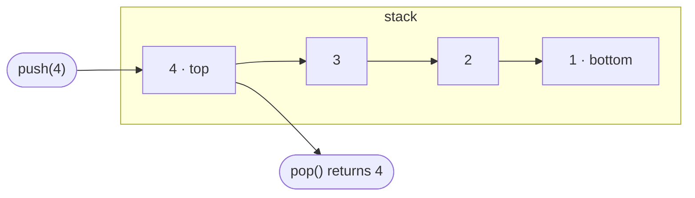
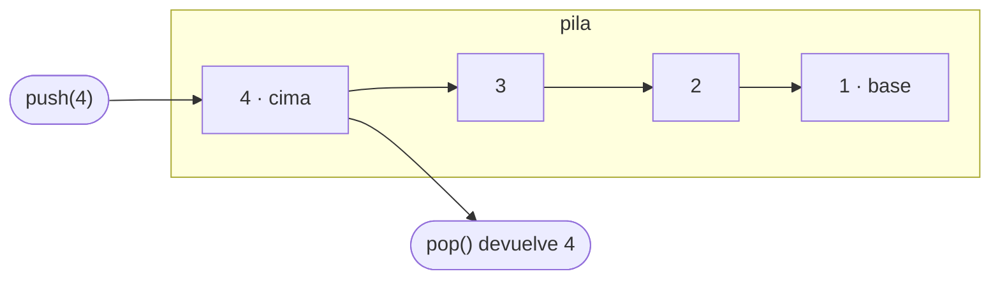

# Fase 0 — Fundación y piloto `stack` Implementation Plan

> **For agentic workers:** REQUIRED SUB-SKILL: Use superpowers:subagent-driven-development (recommended) or superpowers:executing-plans to implement this plan task-by-task. Steps use checkbox (`- [ ]`) syntax for tracking.

**Goal:** Dejar el repositorio listo para que cualquier estructura se añada siguiendo una plantilla: cuatro proyectos (uno por lenguaje) con el mecanismo starter/solución, linters, generador de documentación, CI y la estructura `stack` completa como piloto.

**Architecture:** Layout "lenguaje primero": `typescript/`, `python/`, `java/` y `go/` son proyectos autocontenidos; `structures/` guarda la teoría (EN/ES) y los ejercicios en TOML; `tools/docs.py` (solo stdlib) genera las tablas de catálogo y ejercicios. En cada lenguaje los tests importan el starter y un flag nativo (`--mode solution`, `--solution`, `-Psolution`, `-tags solution`) los redirige a la solución.

**Tech Stack:** TypeScript 6.0 + Vitest 5 + ESLint 10 + Prettier 3 · Python 3.12+ + pytest 9 + Ruff + uv · Java 21 + Gradle 9.8 (Kotlin DSL) + JUnit 6 + Spotless · Go 1.24+ + staticcheck · Python 3.11+ stdlib para `tools/docs.py` · GitHub Actions.

**Spec:** `docs/superpowers/specs/2026-09-27-repo-architecture-design.md`

## Global Constraints

- Rama de trabajo: `phase-0-foundation` (se crea en la Task 1). Nunca se trabaja directo sobre `main`.
- **Un único proyecto por lenguaje.** Ningún lenguaje instala nada fuera de su carpeta: `node_modules/` solo en `typescript/`, `.venv/` solo en `python/`.
- Versiones mínimas: Node **22.13** (Vitest 5 y ESLint 10 no arrancan con 22.0–22.12), Python **3.12**, Java **21** (toolchain de Gradle; Gradle en sí corre con JDK 17+), Go **1.24** (`go.mod`). `tools/docs.py`: Python 3.11+, solo stdlib.
- Dependencias fijadas (verificadas el 2026-09-27): `typescript ~6.0.3` (**no subir a TS 7**: `typescript-eslint 8.70` exige `<6.1.0`), `vitest ^5.0.2`, `eslint ^10.11.0`, `@eslint/js ^10.0.1`, `typescript-eslint ^8.70.1`, `prettier ^3.9.9`, `@types/node ^22.13.0`; `pytest>=9.1`, `ruff>=0.16`; Gradle wrapper **9.8.0**, Spotless **8.10.3**, google-java-format **1.36.1**, JUnit BOM **6.1.3**, foojay-resolver **1.0.0**; staticcheck **2026.2.1**; actionlint **v1.7.12**.
- Los cuerpos de los starters lanzan exactamente el mensaje `TODO: not implemented`.
- El cambio starter → solución se hace con flags nativos, **nunca con variables de entorno** (compatibilidad con Windows). En la documentación, los argumentos se citan con comillas dobles (`--tests "ds.stack.*"`), que funcionan en bash, PowerShell y cmd.
- Código, comentarios y nombres de tests en inglés. Toda la documentación en prosa va en pares `README.md` (EN) + `README.es.md` (ES).
- En `exercises.toml` nunca se copian enunciados: solo título, enlace y un `focus` propio.
- Todos los comandos de un lenguaje se ejecutan **desde su carpeta**; `tools/docs.py` se ejecuta desde la raíz.
- Identidad de git: en este WSL no hay `user.name`/`user.email`. Si `git config user.name` está vacío, cada commit se hace como `git -c user.name="Ruben Alvarado" -c user.email="rubenosmaralvarado@gmail.com" commit ...`.
- Todo mensaje de commit termina con la línea `Co-Authored-By: Claude Opus 5.5 (1M context) <noreply@anthropic.com>`.
- `core.filemode=false` en este repo (vive en NTFS): el bit ejecutable de `java/gradlew` se registra explícitamente con `git update-index --chmod=+x`.

## Review Focus

1. **Valores "falsy" o cero** (`0`, `""`, `false`, `null`/`None`/`nil`) dentro de la pila: un `if (!value)` o un `if node.value:` los confunde con "vacío". Se espera que se guarden y devuelvan como cualquier otro valor. → Test "stores falsy values like any other value" en las Tasks 4, 5 y 6; "stores zero values like any other value" en la Task 7.
2. **Muchos elementos** (100 000): una implementación recursiva agota la pila de llamadas o la recursión de Python. Se espera que funcione sin errores. → Test "handles many values" en las Tasks 4–7.
3. **Go: un panic del starter y el `break` en un range-over-func.** Un panic normal aborta todo `go test` y un iterador que ignora el `false` de `yield` provoca un panic en tiempo de ejecución. Se espera que cada caso falle por separado y que `break` detenga la iteración. → `testutil.Run` y el caso "stops iterating when the loop breaks" en la Task 7.
4. **El repo vive en un sistema de archivos de Windows:** archivos con CRLF no deben hacer fallar `docs.py --check`, y lo que se genera se escribe con LF. → Test `test_check_accepts_windows_line_endings` en la Task 2 y `.gitattributes` en la Task 1.
5. **Estructuras a medio hacer y carpetas de dependencias** (fases 1–14): un starter sin solución no debe romper `pytest --solution` para las demás, el catálogo debe mostrar 🚧, y los `README.md` dentro de `node_modules/` o `.venv/` no deben exigir traducción. → `test_harness.py` en la Task 5; `test_java_needs_a_java_file_to_count_as_done` y `test_ignores_readmes_inside_dependency_and_hidden_folders` en la Task 2.

---

## Mapa de archivos

| Ruta | Responsabilidad | Task |
|---|---|---|
| `.gitignore`, `.gitattributes`, `LICENSE` | Higiene del repo, finales de línea, licencia MIT | 1 |
| `tools/docs.py`, `tools/test_docs.py` | Generar y validar las tablas de catálogo y ejercicios | 2 |
| `structures/catalog.toml`, `README.md`, `README.es.md` | Orden y nombres de las 15 estructuras; portada | 3 |
| `typescript/**` | Proyecto npm: config, `stack` (starter, solución, tests), guía EN/ES | 4 |
| `python/**` | Proyecto uv: `harness.py` + `conftest.py` (flag `--solution`), `stack`, guía EN/ES | 5 |
| `java/**` | Build Gradle: source sets `starter`/`solution`, wrapper, `stack`, guía EN/ES | 6 |
| `go/**` | Módulo Go: `internal/testutil`, `stack` con build tags, guía EN/ES | 7 |
| `structures/stack/**` | Teoría EN/ES y `exercises.toml` del piloto | 8 |
| `.github/workflows/*.yml`, `CONTRIBUTING.md`, `CONTRIBUTING.es.md` | CI y guía de contribución | 9 |

---

### Task 1: Punto de partida limpio

**Files:**
- Modify: `.gitignore` (reemplazo completo)
- Create: `.gitattributes`, `LICENSE`
- Delete (ya borrados en el working tree): `Arrays/`, `DoublyLinkedList/`, `HashTables/`, `LinkedList/`, `Queues/`, `Stacks/`
- Keep: `README.md` (modificado con la lista de 15 estructuras; la Task 3 lo reemplaza)

**Interfaces:**
- Produces: reglas de ignore que **no** excluyen `go.mod`, `go.sum`, `gradle-wrapper.jar`, `package-lock.json` ni `uv.lock`, y sí excluyen `node_modules/`, `.venv*/`, `build/`, `.gradle/`, `.pytest_cache/`. Finales de línea LF en todo el repo salvo `*.bat`.

- [ ] **Step 1: Crear la rama y revisar el estado**

```bash
git switch -c phase-0-foundation
git status --short
```

Expected: solo líneas ` D` de `Arrays/`, `DoublyLinkedList/`, `HashTables/`, `LinkedList/`, `Queues/`, `Stacks/`, y ` M .gitignore`, ` M README.md`. Si aparece otra cosa, detenerse y preguntar.

- [ ] **Step 2: Reemplazar `.gitignore`**

El actual ignora `*.mod`, `*.sum` y `*.jar`, lo que excluiría `go.mod`, `go.sum` y el jar del wrapper de Gradle. Contenido completo:

```text
# Dependencies and build output
node_modules/
build/
dist/
out/
*.tsbuildinfo
*.log

# Python
__pycache__/
*.py[cod]
.venv*/
.pytest_cache/
.ruff_cache/

# Java and Gradle
.gradle/
.kotlin/
*.class

# Go
*.test
*.out

# Editors and operating systems
.idea/
.vscode/
*.iml
*.swp
.DS_Store
Thumbs.db
Desktop.ini

# Local environment
.env
```

- [ ] **Step 3: Crear `.gitattributes`**

```text
# Normalize line endings: LF everywhere, except Windows batch files.
* text=auto eol=lf
*.bat text eol=crlf
*.jar binary
```

- [ ] **Step 4: Crear `LICENSE`**

```text
MIT License

Copyright (c) 2026 Ruben Alvarado

Permission is hereby granted, free of charge, to any person obtaining a copy
of this software and associated documentation files (the "Software"), to deal
in the Software without restriction, including without limitation the rights
to use, copy, modify, merge, publish, distribute, sublicense, and/or sell
copies of the Software, and to permit persons to whom the Software is
furnished to do so, subject to the following conditions:

The above copyright notice and this permission notice shall be included in all
copies or substantial portions of the Software.

THE SOFTWARE IS PROVIDED "AS IS", WITHOUT WARRANTY OF ANY KIND, EXPRESS OR
IMPLIED, INCLUDING BUT NOT LIMITED TO THE WARRANTIES OF MERCHANTABILITY,
FITNESS FOR A PARTICULAR PURPOSE AND NONINFRINGEMENT. IN NO EVENT SHALL THE
AUTHORS OR COPYRIGHT HOLDERS BE LIABLE FOR ANY CLAIM, DAMAGES OR OTHER
LIABILITY, WHETHER IN AN ACTION OF CONTRACT, TORT OR OTHERWISE, ARISING FROM,
OUT OF OR IN CONNECTION WITH THE SOFTWARE OR THE USE OR OTHER DEALINGS IN THE
SOFTWARE.
```

- [ ] **Step 5: Verificar las reglas de ignore**

```bash
for p in go/go.mod go/go.sum java/gradle/wrapper/gradle-wrapper.jar typescript/package-lock.json python/uv.lock; do
  git check-ignore -q "$p" && echo "IGNORED $p" || echo "tracked $p"
done
for p in typescript/node_modules/x python/.venv/x python/.venv312/x java/build/x java/.gradle/x python/.pytest_cache/x; do
  git check-ignore -q "$p" && echo "ignored $p" || echo "NOT-IGNORED $p"
done
```

Expected: las cinco primeras líneas dicen `tracked`; las seis siguientes dicen `ignored`.

- [ ] **Step 6: Commit**

```bash
git add -A
git add --renormalize .
git status --short
git commit -m "$(cat <<'EOF'
chore: start over with a clean repository layout

Remove the previous TypeScript-only implementations, rewrite .gitignore
for the four languages, normalize line endings and add the MIT license.

Co-Authored-By: Claude Opus 5.5 (1M context) <noreply@anthropic.com>
EOF
)"
```

Expected: `git status --short` antes del commit muestra `D` para los archivos viejos, `M .gitignore`, `M README.md`, `A .gitattributes`, `A LICENSE`. Después del commit, `git status --short` queda vacío.

---

### Task 2: Generador de documentación `tools/docs.py`

**Files:**
- Create: `tools/docs.py`
- Test: `tools/test_docs.py`

**Interfaces:**
- Produces:
  - CLI: `python3 tools/docs.py` (regenera) y `python3 tools/docs.py --check` (no escribe; sale con 1 si hay errores o tablas desactualizadas). Errores en stderr con el prefijo `error: `; cada archivo actualizado imprime `updated <ruta>`.
  - `docs.main(argv: list[str] | None = None, root: Path = ROOT) -> int`
  - `docs.solution_status(root: Path, slug: str) -> tuple[bool, bool, bool, bool]` en el orden `LANGUAGE_COLUMNS = ("TypeScript", "Python", "Java", "Go")`.
  - Bloques generados: `<!-- catalog:start -->`/`<!-- catalog:end -->` en `README.md` y `README.es.md` de la raíz; `<!-- exercises:start -->`/`<!-- exercises:end -->` en los README de cada `structures/<slug>/`.
  - Reglas de detección: TS `typescript/src/<slug>/solution.ts`; Python `python/ds/<slug con _>/solution.py`; Java algún `*.java` en `java/src/solution/java/ds/<slug sin ->/`; Go `go/<slug sin ->/solution.go`.

- [ ] **Step 1: Escribir los tests**

`tools/test_docs.py`:

```python
"""Tests for tools/docs.py. Run with: python -m unittest discover -s tools -v"""

import contextlib
import io
import tempfile
import unittest
from pathlib import Path

import docs

CATALOG = """\
[[structure]]
slug = "stack"
name = { en = "Stack", es = "Pila" }

[[structure]]
slug = "linked-list"
name = { en = "Linked List", es = "Lista enlazada" }
"""

EXERCISES = """\
[[exercise]]
id = "valid-parentheses"
title = "Valid Parentheses"
difficulty = "easy"
url = "https://leetcode.com/problems/valid-parentheses/"
focus = { en = "Match pairs in LIFO order", es = "Emparejar pares en orden LIFO" }

[[exercise]]
id = "min-stack"
title = "Min Stack"
difficulty = "medium"
url = "https://leetcode.com/problems/min-stack/"
focus = { en = "Track the minimum", es = "Seguir el mínimo" }
solution = "https://github.com/RubenOAlvarado/algorithms/tree/main/min-stack"
"""

ROOT_README = "# Data Structures\n\n<!-- catalog:start -->\n<!-- catalog:end -->\n"
STACK_README = "# Stack\n\n<!-- exercises:start -->\n<!-- exercises:end -->\n"


def write(path: Path, content: str = "") -> None:
    path.parent.mkdir(parents=True, exist_ok=True)
    path.write_text(content, encoding="utf-8")


class DocsTest(unittest.TestCase):
    def setUp(self) -> None:
        temp = tempfile.TemporaryDirectory()
        self.addCleanup(temp.cleanup)
        self.root = Path(temp.name)
        write(self.root / "structures" / "catalog.toml", CATALOG)
        write(self.root / "README.md", ROOT_README)
        write(self.root / "README.es.md", ROOT_README)
        write(self.root / "structures" / "stack" / "exercises.toml", EXERCISES)
        write(self.root / "structures" / "stack" / "README.md", STACK_README)
        write(self.root / "structures" / "stack" / "README.es.md", STACK_README)
        write(self.root / "typescript" / "src" / "stack" / "solution.ts")
        write(self.root / "python" / "ds" / "stack" / "solution.py")
        write(self.root / "go" / "stack" / "solution.go")

    def run_docs(self, *args: str) -> tuple[int, str]:
        stderr = io.StringIO()
        with contextlib.redirect_stderr(stderr), contextlib.redirect_stdout(io.StringIO()):
            code = docs.main(list(args), root=self.root)
        return code, stderr.getvalue()

    def read(self, relative: str) -> str:
        return (self.root / relative).read_text(encoding="utf-8")

    def test_renders_the_exercise_tables_in_both_languages(self) -> None:
        self.assertEqual(self.run_docs(), (0, ""))
        self.assertIn(
            "| # | Exercise | Difficulty | Practices | Solution |\n"
            "| --- | --- | --- | --- | --- |\n"
            "| 1 | [Valid Parentheses](https://leetcode.com/problems/valid-parentheses/)"
            " | Easy | Match pairs in LIFO order | — |\n"
            "| 2 | [Min Stack](https://leetcode.com/problems/min-stack/) | Medium"
            " | Track the minimum"
            " | [Solution](https://github.com/RubenOAlvarado/algorithms/tree/main/min-stack) |\n"
            "<!-- exercises:end -->",
            self.read("structures/stack/README.md"),
        )
        self.assertIn(
            "| # | Ejercicio | Dificultad | Qué practica | Solución |",
            self.read("structures/stack/README.es.md"),
        )
        self.assertIn(
            "| 1 | [Valid Parentheses](https://leetcode.com/problems/valid-parentheses/)"
            " | Fácil | Emparejar pares en orden LIFO | — |",
            self.read("structures/stack/README.es.md"),
        )

    def test_renders_the_catalog_with_the_detected_status(self) -> None:
        self.assertEqual(self.run_docs(), (0, ""))
        readme = self.read("README.md")
        self.assertIn("| # | Structure | TypeScript | Python | Java | Go |", readme)
        self.assertIn("| 1 | [Stack](structures/stack/README.md) | ✅ | ✅ | 🚧 | ✅ |", readme)
        self.assertIn("| 2 | Linked List | 🚧 | 🚧 | 🚧 | 🚧 |", readme)
        self.assertIn(
            "| 1 | [Pila](structures/stack/README.es.md) | ✅ | ✅ | 🚧 | ✅ |",
            self.read("README.es.md"),
        )

    def test_adapts_the_slug_to_each_language_when_detecting_solutions(self) -> None:
        write(self.root / "typescript" / "src" / "linked-list" / "solution.ts")
        write(self.root / "python" / "ds" / "linked_list" / "solution.py")
        write(self.root / "java" / "src" / "solution" / "java" / "ds" / "linkedlist" / "A.java")
        write(self.root / "go" / "linkedlist" / "solution.go")
        self.assertEqual(self.run_docs(), (0, ""))
        self.assertIn("| 2 | Linked List | ✅ | ✅ | ✅ | ✅ |", self.read("README.md"))

    def test_java_needs_a_java_file_to_count_as_done(self) -> None:
        (self.root / "java" / "src" / "solution" / "java" / "ds" / "stack").mkdir(parents=True)
        self.assertEqual(self.run_docs(), (0, ""))
        self.assertIn("| ✅ | ✅ | 🚧 | ✅ |", self.read("README.md"))

    def test_check_passes_after_generating(self) -> None:
        self.run_docs()
        self.assertEqual(self.run_docs("--check"), (0, ""))

    def test_check_fails_without_writing_when_a_table_is_out_of_date(self) -> None:
        self.run_docs()
        exercises = self.root / "structures" / "stack" / "exercises.toml"
        write(exercises, EXERCISES.replace("Min Stack", "Minimum Stack"))
        before = self.read("structures/stack/README.md")
        code, errors = self.run_docs("--check")
        self.assertEqual(code, 1)
        self.assertIn("structures/stack/README.md: out of date", errors)
        self.assertEqual(self.read("structures/stack/README.md"), before)

    def test_check_accepts_windows_line_endings(self) -> None:
        self.run_docs()
        readme = self.root / "structures" / "stack" / "README.md"
        readme.write_bytes(readme.read_bytes().replace(b"\n", b"\r\n"))
        self.assertEqual(self.run_docs("--check"), (0, ""))

    def test_rejects_unknown_keys(self) -> None:
        exercises = self.root / "structures" / "stack" / "exercises.toml"
        write(exercises, EXERCISES.replace('difficulty = "easy"', 'dificulty = "easy"'))
        code, errors = self.run_docs()
        self.assertEqual(code, 1)
        self.assertIn(
            "structures/stack/exercises.toml: exercise #1: unknown key 'dificulty'", errors
        )
        self.assertIn(
            "structures/stack/exercises.toml: exercise #1: missing key 'difficulty'", errors
        )

    def test_rejects_an_invalid_difficulty(self) -> None:
        exercises = self.root / "structures" / "stack" / "exercises.toml"
        write(exercises, EXERCISES.replace('"easy"', '"trivial"'))
        code, errors = self.run_docs("--check")
        self.assertEqual(code, 1)
        self.assertIn("'difficulty' must be one of easy, medium, hard", errors)

    def test_rejects_focus_without_both_languages(self) -> None:
        exercises = self.root / "structures" / "stack" / "exercises.toml"
        write(exercises, EXERCISES.replace(', es = "Seguir el mínimo"', ""))
        code, errors = self.run_docs("--check")
        self.assertEqual(code, 1)
        self.assertIn("exercise #2: 'focus' must have non-empty 'en' and 'es' texts", errors)

    def test_rejects_invalid_toml(self) -> None:
        write(self.root / "structures" / "stack" / "exercises.toml", "[[exercise]\n")
        code, errors = self.run_docs("--check")
        self.assertEqual(code, 1)
        self.assertIn("structures/stack/exercises.toml: invalid TOML", errors)

    def test_rejects_an_exercise_id_used_by_two_structures(self) -> None:
        write(self.root / "structures" / "linked-list" / "exercises.toml", EXERCISES)
        write(self.root / "structures" / "linked-list" / "README.md", STACK_README)
        write(self.root / "structures" / "linked-list" / "README.es.md", STACK_README)
        code, errors = self.run_docs("--check")
        self.assertEqual(code, 1)
        self.assertIn(
            "structures/stack/exercises.toml: exercise id 'valid-parentheses'"
            " is already used in structures/linked-list",
            errors,
        )

    def test_rejects_a_structure_folder_missing_from_the_catalog(self) -> None:
        write(self.root / "structures" / "queue" / "exercises.toml", "")
        write(self.root / "structures" / "queue" / "README.md", STACK_README)
        write(self.root / "structures" / "queue" / "README.es.md", STACK_README)
        code, errors = self.run_docs("--check")
        self.assertEqual(code, 1)
        self.assertIn("structures/queue: not listed in structures/catalog.toml", errors)

    def test_requires_every_readme_to_have_its_translation(self) -> None:
        write(self.root / "typescript" / "README.md", "# TypeScript\n")
        code, errors = self.run_docs("--check")
        self.assertEqual(code, 1)
        self.assertIn("typescript/README.md: missing its pair README.es.md", errors)

    def test_ignores_readmes_inside_dependency_and_hidden_folders(self) -> None:
        write(self.root / "typescript" / "node_modules" / "vitest" / "README.md", "# vitest\n")
        write(self.root / "python" / ".venv" / "lib" / "README.md", "# lib\n")
        self.run_docs()
        self.assertEqual(self.run_docs("--check"), (0, ""))

    def test_requires_the_generated_block_markers(self) -> None:
        write(self.root / "structures" / "stack" / "README.es.md", "# Pila\n")
        code, errors = self.run_docs()
        self.assertEqual(code, 1)
        self.assertIn(
            "structures/stack/README.es.md: expected exactly one '<!-- exercises:start -->'",
            errors,
        )


if __name__ == "__main__":
    unittest.main()
```

- [ ] **Step 2: Correr los tests y verificar que fallan**

Run (desde la raíz): `python3 -m unittest discover -s tools -v`
Expected: FAIL con `ModuleNotFoundError: No module named 'docs'`.

- [ ] **Step 3: Implementar `tools/docs.py`**

```python
#!/usr/bin/env python3
"""Generate and validate the generated parts of the documentation.

Usage (from the repository root):
    python tools/docs.py          regenerate the catalog and exercise tables
    python tools/docs.py --check  fail if the data is invalid or a table is out of date

Requires Python 3.11+ and nothing outside the standard library.
"""

import argparse
import os
import re
import sys
import tomllib
from dataclasses import dataclass
from pathlib import Path

ROOT = Path(__file__).resolve().parent.parent
LANGUAGES = ("en", "es")
README = {"en": "README.md", "es": "README.es.md"}
DIFFICULTIES = ("easy", "medium", "hard")
SLUG = re.compile(r"^[a-z0-9]+(-[a-z0-9]+)*$")
SKIPPED_DIRS = {"node_modules", "build", "dist", "target"}

DIFFICULTY_LABELS = {
    "en": {"easy": "Easy", "medium": "Medium", "hard": "Hard"},
    "es": {"easy": "Fácil", "medium": "Media", "hard": "Difícil"},
}
EXERCISE_HEADERS = {
    "en": ("#", "Exercise", "Difficulty", "Practices", "Solution"),
    "es": ("#", "Ejercicio", "Dificultad", "Qué practica", "Solución"),
}
SOLUTION_LINK = {"en": "Solution", "es": "Solución"}
LANGUAGE_COLUMNS = ("TypeScript", "Python", "Java", "Go")
CATALOG_HEADERS = {
    "en": ("#", "Structure", *LANGUAGE_COLUMNS),
    "es": ("#", "Estructura", *LANGUAGE_COLUMNS),
}


class DocsError(Exception):
    """A problem in the documentation sources."""


@dataclass(frozen=True)
class Structure:
    slug: str
    name: dict[str, str]


@dataclass(frozen=True)
class Exercise:
    id: str
    title: str
    difficulty: str
    url: str
    focus: dict[str, str]
    solution: str


def rel(root: Path, path: Path) -> str:
    return path.relative_to(root).as_posix()


def load_toml(root: Path, path: Path, errors: list[str]) -> dict:
    try:
        with path.open("rb") as file:
            return tomllib.load(file)
    except tomllib.TOMLDecodeError as error:
        errors.append(f"{rel(root, path)}: invalid TOML: {error}")
        return {}


def check_keys(
    table: object, required: set[str], optional: set[str], where: str, errors: list[str]
) -> bool:
    if not isinstance(table, dict):
        errors.append(f"{where}: expected a table")
        return False
    for key in sorted(required - table.keys()):
        errors.append(f"{where}: missing key '{key}'")
    for key in sorted(table.keys() - required - optional):
        errors.append(f"{where}: unknown key '{key}'")
    return required <= table.keys()


def check_text(table: dict, key: str, where: str, errors: list[str]) -> bool:
    value = table[key]
    if not isinstance(value, str) or not value.strip():
        errors.append(f"{where}: '{key}' must be non-empty text")
        return False
    return True


def check_localized(table: dict, key: str, where: str, errors: list[str]) -> bool:
    value = table[key]
    valid = (
        isinstance(value, dict)
        and set(value) == set(LANGUAGES)
        and all(isinstance(text, str) and text.strip() for text in value.values())
    )
    if not valid:
        errors.append(f"{where}: '{key}' must have non-empty 'en' and 'es' texts and nothing else")
    return valid


def check_url(table: dict, key: str, where: str, errors: list[str]) -> bool:
    if not check_text(table, key, where, errors):
        return False
    if not table[key].startswith("https://"):
        errors.append(f"{where}: '{key}' must start with https://")
        return False
    return True


def load_catalog(root: Path, errors: list[str]) -> list[Structure]:
    path = root / "structures" / "catalog.toml"
    if not path.is_file():
        errors.append("structures/catalog.toml: file not found")
        return []
    data = load_toml(root, path, errors)
    check_keys(data, set(), {"structure"}, rel(root, path), errors)
    structures: list[Structure] = []
    for number, entry in enumerate(data.get("structure", []), start=1):
        where = f"{rel(root, path)}: structure #{number}"
        if not check_keys(entry, {"slug", "name"}, set(), where, errors):
            continue
        if not isinstance(entry["slug"], str) or not SLUG.match(entry["slug"]):
            errors.append(f"{where}: 'slug' must be kebab-case, like 'linked-list'")
            continue
        if not check_localized(entry, "name", where, errors):
            continue
        if any(structure.slug == entry["slug"] for structure in structures):
            errors.append(f"{where}: slug '{entry['slug']}' is listed twice")
            continue
        structures.append(Structure(entry["slug"], entry["name"]))
    return structures


def load_exercises(root: Path, path: Path, errors: list[str]) -> list[Exercise]:
    data = load_toml(root, path, errors)
    check_keys(data, set(), {"exercise"}, rel(root, path), errors)
    exercises: list[Exercise] = []
    for number, entry in enumerate(data.get("exercise", []), start=1):
        where = f"{rel(root, path)}: exercise #{number}"
        required = {"id", "title", "difficulty", "url", "focus"}
        if not check_keys(entry, required, {"solution"}, where, errors):
            continue
        valid = all(
            [
                check_text(entry, "id", where, errors),
                check_text(entry, "title", where, errors),
                check_url(entry, "url", where, errors),
                check_localized(entry, "focus", where, errors),
            ]
        )
        if isinstance(entry["id"], str) and not SLUG.match(entry["id"]):
            errors.append(f"{where}: 'id' must be kebab-case, like 'valid-parentheses'")
            valid = False
        if entry["difficulty"] not in DIFFICULTIES:
            errors.append(f"{where}: 'difficulty' must be one of {', '.join(DIFFICULTIES)}")
            valid = False
        solution = entry.get("solution", "")
        if solution and not check_url(entry, "solution", where, errors):
            valid = False
        if valid:
            exercises.append(
                Exercise(
                    id=entry["id"],
                    title=entry["title"],
                    difficulty=entry["difficulty"],
                    url=entry["url"],
                    focus=entry["focus"],
                    solution=solution,
                )
            )
    return exercises


def row(cells: tuple[str, ...] | list[str]) -> str:
    return "| " + " | ".join(cell.replace("|", "\\|") for cell in cells) + " |"


def render_exercises(exercises: list[Exercise], lang: str) -> str:
    lines = [row(EXERCISE_HEADERS[lang]), row(["---"] * len(EXERCISE_HEADERS[lang]))]
    for number, exercise in enumerate(exercises, start=1):
        solution = f"[{SOLUTION_LINK[lang]}]({exercise.solution})" if exercise.solution else "—"
        lines.append(
            row(
                [
                    str(number),
                    f"[{exercise.title}]({exercise.url})",
                    DIFFICULTY_LABELS[lang][exercise.difficulty],
                    exercise.focus[lang],
                    solution,
                ]
            )
        )
    return "\n".join(lines)


def solution_status(root: Path, slug: str) -> tuple[bool, bool, bool, bool]:
    """Whether each language (TypeScript, Python, Java, Go) has a solution for `slug`."""
    snake = slug.replace("-", "_")
    package = slug.replace("-", "")
    java_dir = root / "java" / "src" / "solution" / "java" / "ds" / package
    return (
        (root / "typescript" / "src" / slug / "solution.ts").is_file(),
        (root / "python" / "ds" / snake / "solution.py").is_file(),
        java_dir.is_dir() and any(java_dir.glob("*.java")),
        (root / "go" / package / "solution.go").is_file(),
    )


def render_catalog(root: Path, structures: list[Structure], lang: str) -> str:
    lines = [row(CATALOG_HEADERS[lang]), row(["---"] * len(CATALOG_HEADERS[lang]))]
    for number, structure in enumerate(structures, start=1):
        readme = f"structures/{structure.slug}/{README[lang]}"
        name = structure.name[lang]
        if (root / readme).is_file():
            name = f"[{name}]({readme})"
        marks = ["✅" if done else "🚧" for done in solution_status(root, structure.slug)]
        lines.append(row([str(number), name, *marks]))
    return "\n".join(lines)


def replace_block(text: str, block: str, content: str) -> str:
    start, end = f"<!-- {block}:start -->", f"<!-- {block}:end -->"
    pattern = re.compile(re.escape(start) + ".*?" + re.escape(end), re.DOTALL)
    if len(pattern.findall(text)) != 1:
        raise DocsError(f"expected exactly one '{start}' ... '{end}' block")
    return pattern.sub(lambda _: f"{start}\n{content}\n{end}", text)


def find_unpaired_readmes(root: Path) -> list[str]:
    errors = []
    for directory, subdirectories, files in os.walk(root):
        subdirectories[:] = sorted(
            name for name in subdirectories if not name.startswith(".") and name not in SKIPPED_DIRS
        )
        for lang, other in (("en", "es"), ("es", "en")):
            if README[lang] in files and README[other] not in files:
                path = Path(directory) / README[lang]
                errors.append(f"{rel(root, path)}: missing its pair {README[other]}")
    return errors


def render_into(
    root: Path, path: Path, block: str, content: str, outputs: dict[Path, str], errors: list[str]
) -> None:
    if not path.is_file():
        errors.append(f"{rel(root, path)}: file not found")
        return
    current = outputs.get(path, path.read_text(encoding="utf-8"))
    try:
        outputs[path] = replace_block(current, block, content)
    except DocsError as error:
        errors.append(f"{rel(root, path)}: {error}")


def build(root: Path) -> tuple[dict[Path, str], list[str]]:
    """Return the expected content of every generated file and the problems found."""
    errors: list[str] = []
    outputs: dict[Path, str] = {}
    structures = load_catalog(root, errors)
    listed = {structure.slug for structure in structures}
    structures_dir = root / "structures"
    folders = sorted(path for path in structures_dir.glob("*") if path.is_dir())
    owners: dict[str, str] = {}
    for folder in folders:
        if folder.name not in listed:
            errors.append(f"structures/{folder.name}: not listed in structures/catalog.toml")
        exercises_path = folder / "exercises.toml"
        if not exercises_path.is_file():
            errors.append(f"structures/{folder.name}: missing exercises.toml")
            continue
        exercises = load_exercises(root, exercises_path, errors)
        for exercise in exercises:
            owner = owners.setdefault(exercise.id, folder.name)
            if owner != folder.name:
                errors.append(
                    f"structures/{folder.name}/exercises.toml: exercise id '{exercise.id}'"
                    f" is already used in structures/{owner}"
                )
        for lang in LANGUAGES:
            content = render_exercises(exercises, lang)
            render_into(root, folder / README[lang], "exercises", content, outputs, errors)
    for lang in LANGUAGES:
        content = render_catalog(root, structures, lang)
        render_into(root, root / README[lang], "catalog", content, outputs, errors)
    errors.extend(find_unpaired_readmes(root))
    return outputs, errors


def main(argv: list[str] | None = None, root: Path = ROOT) -> int:
    parser = argparse.ArgumentParser(description="Generate and validate the documentation tables.")
    parser.add_argument(
        "--check",
        action="store_true",
        help="do not write anything; fail if the data is invalid or a table is out of date",
    )
    args = parser.parse_args(argv)
    outputs, errors = build(root)
    stale = [path for path, text in outputs.items() if path.read_text(encoding="utf-8") != text]
    if args.check and not errors:
        errors = [f"{rel(root, path)}: out of date, run `python tools/docs.py`" for path in stale]
    if errors:
        for error in errors:
            print(f"error: {error}", file=sys.stderr)
        return 1
    if not args.check:
        for path in stale:
            path.write_text(outputs[path], encoding="utf-8", newline="\n")
            print(f"updated {rel(root, path)}")
    return 0


if __name__ == "__main__":
    sys.exit(main())
```

- [ ] **Step 4: Correr los tests y verificar que pasan**

Run: `python3 -m unittest discover -s tools -v`
Expected: `Ran 16 tests` y `OK`.

- [ ] **Step 5: Commit**

```bash
git add tools/docs.py tools/test_docs.py
git commit -m "$(cat <<'EOF'
feat: add the documentation generator and validator

tools/docs.py renders the catalog and exercise tables from TOML files and
checks the schema, duplicated ids, README translations and stale tables.

Co-Authored-By: Claude Opus 5.5 (1M context) <noreply@anthropic.com>
EOF
)"
```

---

### Task 3: Catálogo y README raíz

**Files:**
- Create: `structures/catalog.toml`, `README.es.md`
- Modify: `README.md` (reemplazo completo)

**Interfaces:**
- Consumes: `python3 tools/docs.py [--check]` (Task 2).
- Produces: el orden y los nombres EN/ES de las 15 estructuras; los slugs que usan todas las tasks siguientes (`stack` es el 4.º).

- [ ] **Step 1: Crear `structures/catalog.toml`**

```toml
# The order of this list is the recommended learning path.
# `python tools/docs.py` turns it into the catalog table of the root READMEs.

[[structure]]
slug = "array"
name = { en = "Array", es = "Arreglo" }

[[structure]]
slug = "string"
name = { en = "String", es = "Cadena" }

[[structure]]
slug = "linked-list"
name = { en = "Linked List", es = "Lista enlazada" }

[[structure]]
slug = "stack"
name = { en = "Stack", es = "Pila" }

[[structure]]
slug = "queue"
name = { en = "Queue", es = "Cola" }

[[structure]]
slug = "deque"
name = { en = "Deque", es = "Cola doble (deque)" }

[[structure]]
slug = "hash-table"
name = { en = "Hash Table", es = "Tabla hash" }

[[structure]]
slug = "binary-tree"
name = { en = "Binary Tree", es = "Árbol binario" }

[[structure]]
slug = "binary-search-tree"
name = { en = "Binary Search Tree", es = "Árbol binario de búsqueda" }

[[structure]]
slug = "heap"
name = { en = "Heap / Priority Queue", es = "Heap / Cola de prioridad" }

[[structure]]
slug = "trie"
name = { en = "Trie", es = "Trie" }

[[structure]]
slug = "graph"
name = { en = "Graph", es = "Grafo" }

[[structure]]
slug = "union-find"
name = { en = "Union-Find", es = "Union-Find (conjuntos disjuntos)" }

[[structure]]
slug = "lru-cache"
name = { en = "LRU Cache", es = "Caché LRU" }

[[structure]]
slug = "lfu-cache"
name = { en = "LFU Cache", es = "Caché LFU" }
```

- [ ] **Step 2: Reemplazar `README.md`**

````markdown
# Data Structures

> Learn the classic data structures by building them yourself, in TypeScript, Python, Java or Go.

[Leer en español](README.es.md)

This repository is a workshop to prepare for technical interviews and to review the fundamentals. For every data structure you will find:

- **The theory:** the mental model, the operations and their complexity, when to use it and its trade-offs.
- **A starter** in each language: the public API and its contract, ready for you to implement.
- **Tests** that tell you when your implementation is correct.
- **A reference solution** to compare with once you are done.
- **Suggested exercises** to practice using the structure.

This repository only contains data structures. Algorithms and the solutions to the exercises live in a separate repository.

## How to study a structure

1. Read the theory in `structures/<name>/README.md`.
2. Pick your language and set it up once: [TypeScript](typescript/README.md), [Python](python/README.md), [Java](java/README.md) or [Go](go/README.md).
3. Implement the starter. Only edit the `starter` file.
4. Run the tests until they all pass.
5. Compare your code with the reference solution.
6. Practice with the suggested exercises at the end of the theory.

Each language is an independent project: you only install the tools of the language you pick.

## Catalog

The order is the recommended learning path. ✅ means the structure is ready in that language; 🚧 means it is still in progress.

<!-- catalog:start -->
<!-- catalog:end -->

## Contributing

Read [CONTRIBUTING.md](CONTRIBUTING.md).

## License

[MIT](LICENSE)
````

- [ ] **Step 3: Crear `README.es.md`**

````markdown
# Estructuras de datos

> Aprende las estructuras de datos clásicas construyéndolas por tu cuenta, en TypeScript, Python, Java o Go.

[Read in English](README.md)

Este repositorio es un taller para preparar entrevistas técnicas y repasar los fundamentos. Para cada estructura de datos encontrarás:

- **La teoría:** el modelo mental, las operaciones y su complejidad, cuándo usarla y sus trade-offs.
- **Un starter** en cada lenguaje: la API pública y su contrato, listos para que los implementes.
- **Tests** que te dicen cuándo tu implementación es correcta.
- **Una solución de referencia** para comparar cuando termines.
- **Ejercicios sugeridos** para practicar el uso de la estructura.

Este repositorio solo contiene estructuras de datos. Los algoritmos y las soluciones de los ejercicios viven en un repositorio aparte.

## Cómo estudiar una estructura

1. Lee la teoría en `structures/<nombre>/README.es.md`.
2. Elige tu lenguaje y configúralo una sola vez: [TypeScript](typescript/README.es.md), [Python](python/README.es.md), [Java](java/README.es.md) o [Go](go/README.es.md).
3. Implementa el starter. Edita solo el archivo `starter`.
4. Corre los tests hasta que pasen todos.
5. Compara tu código con la solución de referencia.
6. Practica con los ejercicios sugeridos al final de la teoría.

Cada lenguaje es un proyecto independiente: solo instalas las herramientas del lenguaje que elijas.

## Catálogo

El orden es la ruta de aprendizaje recomendada. ✅ indica que la estructura está lista en ese lenguaje; 🚧, que todavía está en progreso.

<!-- catalog:start -->
<!-- catalog:end -->

## Contribuir

Lee [CONTRIBUTING.es.md](CONTRIBUTING.es.md).

## Licencia

[MIT](LICENSE)
````

- [ ] **Step 4: Verificar que el check detecta las tablas vacías**

Run: `python3 tools/docs.py --check`
Expected: exit 1 con `error: README.md: out of date, run `python tools/docs.py`` y la misma línea para `README.es.md`.

- [ ] **Step 5: Generar el catálogo**

Run: `python3 tools/docs.py`
Expected: `updated README.md` y `updated README.es.md`. El bloque de `README.md` queda así (el de `README.es.md` es igual, con los nombres en español y la cabecera `Estructura`):

```markdown
<!-- catalog:start -->
| # | Structure | TypeScript | Python | Java | Go |
| --- | --- | --- | --- | --- | --- |
| 1 | Array | 🚧 | 🚧 | 🚧 | 🚧 |
| 2 | String | 🚧 | 🚧 | 🚧 | 🚧 |
| 3 | Linked List | 🚧 | 🚧 | 🚧 | 🚧 |
| 4 | Stack | 🚧 | 🚧 | 🚧 | 🚧 |
| 5 | Queue | 🚧 | 🚧 | 🚧 | 🚧 |
| 6 | Deque | 🚧 | 🚧 | 🚧 | 🚧 |
| 7 | Hash Table | 🚧 | 🚧 | 🚧 | 🚧 |
| 8 | Binary Tree | 🚧 | 🚧 | 🚧 | 🚧 |
| 9 | Binary Search Tree | 🚧 | 🚧 | 🚧 | 🚧 |
| 10 | Heap / Priority Queue | 🚧 | 🚧 | 🚧 | 🚧 |
| 11 | Trie | 🚧 | 🚧 | 🚧 | 🚧 |
| 12 | Graph | 🚧 | 🚧 | 🚧 | 🚧 |
| 13 | Union-Find | 🚧 | 🚧 | 🚧 | 🚧 |
| 14 | LRU Cache | 🚧 | 🚧 | 🚧 | 🚧 |
| 15 | LFU Cache | 🚧 | 🚧 | 🚧 | 🚧 |
<!-- catalog:end -->
```

- [ ] **Step 6: Verificar que el check pasa**

Run: `python3 tools/docs.py --check`
Expected: exit 0, sin salida.

- [ ] **Step 7: Commit**

```bash
git add structures/catalog.toml README.md README.es.md
git commit -m "$(cat <<'EOF'
docs: add the bilingual landing page and the structure catalog

Co-Authored-By: Claude Opus 5.5 (1M context) <noreply@anthropic.com>
EOF
)"
```

---

### Task 4: Proyecto TypeScript y `stack`

**Files:**
- Create: `typescript/package.json`, `typescript/package-lock.json` (lo genera npm), `typescript/tsconfig.json`, `typescript/vitest.config.ts`, `typescript/eslint.config.js`, `typescript/.prettierrc.json`, `typescript/README.md`, `typescript/README.es.md`
- Create: `typescript/src/stack/starter.ts`, `typescript/src/stack/solution.ts`
- Test: `typescript/src/stack/stack.test.ts`
- Modify: `README.md`, `README.es.md` (catálogo regenerado)

**Interfaces:**
- Consumes: `python3 tools/docs.py` (Task 2).
- Produces:
  - Scripts npm: `test` (Vitest en watch contra el starter), `test:solution` (`vitest run --mode solution`), `typecheck`, `lint`, `format`, `format:check`.
  - Contrato del plugin: con `--mode solution`, cualquier import `./starter`, `./starter.ts` o `./starter.js` se resuelve al `solution.ts` del mismo directorio. **Los tests de todas las estructuras deben importar el starter exactamente como `./starter`.**
  - API: `export class Stack<T> implements Iterable<T>` con `push(value: T): void`, `pop(): T | undefined`, `peek(): T | undefined`, `get size(): number`, `isEmpty(): boolean`, `[Symbol.iterator](): Iterator<T>`.

- [ ] **Step 1: Crear la configuración del proyecto**

`typescript/package.json`:

```json
{
  "name": "data-structures-typescript",
  "private": true,
  "type": "module",
  "engines": {
    "node": ">=22.13"
  },
  "scripts": {
    "test": "vitest",
    "test:solution": "vitest run --mode solution",
    "typecheck": "tsc --noEmit",
    "lint": "eslint .",
    "format": "prettier --write .",
    "format:check": "prettier --check ."
  },
  "devDependencies": {
    "@eslint/js": "^10.0.1",
    "@types/node": "^22.13.0",
    "eslint": "^10.11.0",
    "prettier": "^3.9.9",
    "typescript": "~6.0.3",
    "typescript-eslint": "^8.70.1",
    "vitest": "^5.0.2"
  }
}
```

`typescript/tsconfig.json`:

```json
{
  "compilerOptions": {
    "target": "ES2023",
    "lib": ["ES2023"],
    "module": "ESNext",
    "moduleResolution": "bundler",
    "types": ["node"],
    "strict": true,
    "noEmit": true,
    "isolatedModules": true,
    "verbatimModuleSyntax": true,
    "noUncheckedIndexedAccess": true,
    "noImplicitOverride": true,
    "skipLibCheck": true
  },
  "include": ["src", "vitest.config.ts"]
}
```

`typescript/vitest.config.ts`:

```ts
import { dirname, join } from "node:path";
import { defineConfig } from "vitest/config";

// `npm run test:solution` runs Vitest with `--mode solution`. In that mode every
// `./starter` import is redirected to the sibling `solution.ts`, so the same tests
// validate both the learner's starter and the reference solution.
const useSolution = {
  name: "use-solution",
  enforce: "pre" as const,
  resolveId(source: string, importer: string | undefined) {
    if (importer !== undefined && /^\.\/starter(\.[jt]s)?$/.test(source)) {
      return join(dirname(importer), "solution.ts");
    }
    return null;
  },
};

export default defineConfig(({ mode }) => ({
  plugins: mode === "solution" ? [useSolution] : [],
  test: {
    include: ["src/**/*.test.ts"],
  },
}));
```

`typescript/eslint.config.js`:

```js
import js from "@eslint/js";
import { defineConfig } from "eslint/config";
import tseslint from "typescript-eslint";

export default defineConfig(js.configs.recommended, tseslint.configs.strict, {
  // Starter methods only throw "TODO", so their parameters are unused on purpose.
  files: ["src/**/starter.ts"],
  rules: {
    "@typescript-eslint/no-unused-vars": "off",
  },
});
```

`typescript/.prettierrc.json`:

```json
{}
```

- [ ] **Step 2: Instalar dependencias**

Run (desde `typescript/`): `npm install`
Expected: se crean `typescript/node_modules/` y `typescript/package-lock.json`, sin errores de peer dependencies. Desde la raíz, `ls node_modules 2>/dev/null` no muestra nada.

- [ ] **Step 3: Escribir los tests**

`typescript/src/stack/stack.test.ts`:

```ts
import { describe, expect, it } from "vitest";
import { Stack } from "./starter";

describe("Stack", () => {
  it("starts empty", () => {
    const stack = new Stack<number>();
    expect(stack.size).toBe(0);
    expect(stack.isEmpty()).toBe(true);
  });

  it("grows with each push", () => {
    const stack = new Stack<number>();
    stack.push(1);
    stack.push(2);
    expect(stack.size).toBe(2);
    expect(stack.isEmpty()).toBe(false);
  });

  it("peeks at the last pushed value without removing it", () => {
    const stack = new Stack<number>();
    stack.push(1);
    stack.push(2);
    expect(stack.peek()).toBe(2);
    expect(stack.size).toBe(2);
  });

  it("pops values in LIFO order", () => {
    const stack = new Stack<number>();
    stack.push(1);
    stack.push(2);
    stack.push(3);
    expect(stack.pop()).toBe(3);
    expect(stack.pop()).toBe(2);
    expect(stack.pop()).toBe(1);
    expect(stack.size).toBe(0);
  });

  it("returns undefined from pop and peek when empty", () => {
    const stack = new Stack<number>();
    expect(stack.pop()).toBeUndefined();
    expect(stack.peek()).toBeUndefined();
    expect(stack.size).toBe(0);
  });

  it("can be reused after being emptied", () => {
    const stack = new Stack<number>();
    stack.push(1);
    stack.pop();
    expect(stack.isEmpty()).toBe(true);
    stack.push(2);
    expect(stack.peek()).toBe(2);
    expect(stack.size).toBe(1);
  });

  it("keeps LIFO order when push and pop are interleaved", () => {
    const stack = new Stack<number>();
    stack.push(1);
    stack.push(2);
    expect(stack.pop()).toBe(2);
    stack.push(3);
    expect(stack.pop()).toBe(3);
    expect(stack.pop()).toBe(1);
  });

  it("iterates from top to bottom without modifying the stack", () => {
    const stack = new Stack<number>();
    stack.push(1);
    stack.push(2);
    stack.push(3);
    expect([...stack]).toEqual([3, 2, 1]);
    expect([...stack]).toEqual([3, 2, 1]);
    expect(stack.size).toBe(3);
  });

  it("works with non-numeric values", () => {
    const stack = new Stack<string>();
    stack.push("a");
    stack.push("b");
    expect(stack.pop()).toBe("b");
    expect(stack.peek()).toBe("a");
  });

  it("stores falsy values like any other value", () => {
    const stack = new Stack<number | string | boolean | null>();
    stack.push(0);
    stack.push("");
    stack.push(false);
    stack.push(null);
    expect(stack.size).toBe(4);
    expect(stack.pop()).toBeNull();
    expect(stack.pop()).toBe(false);
    expect(stack.pop()).toBe("");
    expect(stack.peek()).toBe(0);
    expect(stack.isEmpty()).toBe(false);
  });

  it("handles many values", () => {
    const stack = new Stack<number>();
    const count = 100_000;
    for (let i = 0; i < count; i++) {
      stack.push(i);
    }
    expect(stack.size).toBe(count);
    const popped: (number | undefined)[] = [];
    while (!stack.isEmpty()) {
      popped.push(stack.pop());
    }
    expect(popped).toEqual(
      Array.from({ length: count }, (_, i) => count - 1 - i),
    );
  });
});
```

- [ ] **Step 4: Escribir el starter**

`typescript/src/stack/starter.ts`:

```ts
/**
 * A last-in, first-out (LIFO) collection.
 *
 * Build it on linked nodes: do not use a native array as storage, because that
 * would be using JavaScript's built-in stack.
 *
 * Target complexity: O(1) for push, pop, peek, size and isEmpty.
 */
export class Stack<T> implements Iterable<T> {
  /** Adds `value` on top of the stack. */
  push(value: T): void {
    throw new Error("TODO: not implemented");
  }

  /** Removes and returns the top value, or returns `undefined` if the stack is empty. */
  pop(): T | undefined {
    throw new Error("TODO: not implemented");
  }

  /** Returns the top value without removing it, or `undefined` if the stack is empty. */
  peek(): T | undefined {
    throw new Error("TODO: not implemented");
  }

  /** Number of values in the stack. */
  get size(): number {
    throw new Error("TODO: not implemented");
  }

  /** Whether the stack has no values. */
  isEmpty(): boolean {
    throw new Error("TODO: not implemented");
  }

  /** Yields the values from top to bottom without modifying the stack. */
  [Symbol.iterator](): Iterator<T> {
    throw new Error("TODO: not implemented");
  }
}
```

- [ ] **Step 5: Verificar que los tests fallan contra el starter**

Run: `npx vitest run`
Expected: `Tests  11 failed (11)`; cada fallo muestra `Error: TODO: not implemented`.

- [ ] **Step 6: Escribir la solución**

`typescript/src/stack/solution.ts`:

```ts
interface Node<T> {
  value: T;
  next: Node<T> | undefined;
}

export class Stack<T> implements Iterable<T> {
  #top: Node<T> | undefined = undefined;
  #size = 0;

  push(value: T): void {
    this.#top = { value, next: this.#top };
    this.#size++;
  }

  pop(): T | undefined {
    const top = this.#top;
    if (top === undefined) {
      return undefined;
    }
    this.#top = top.next;
    this.#size--;
    return top.value;
  }

  peek(): T | undefined {
    return this.#top?.value;
  }

  get size(): number {
    return this.#size;
  }

  isEmpty(): boolean {
    return this.#size === 0;
  }

  *[Symbol.iterator](): Iterator<T> {
    for (let node = this.#top; node !== undefined; node = node.next) {
      yield node.value;
    }
  }
}
```

- [ ] **Step 7: Verificar que los tests pasan contra la solución**

Run: `npm run test:solution`
Expected: `Tests  11 passed (11)`.

- [ ] **Step 8: Escribir la guía del lenguaje**

`typescript/README.md`:

````markdown
# TypeScript

[Leer en español](README.es.md)

## Requirements

- Node.js 22.13 or newer (it includes npm).

## Setup

From this folder:

```bash
npm install
```

It installs TypeScript, Vitest, ESLint and Prettier in `typescript/node_modules`. Nothing is installed anywhere else.

## Layout

Each structure has its own folder in `src/`:

```
src/stack/
├── starter.ts      ← your implementation goes here
├── solution.ts     ← reference solution
└── stack.test.ts   ← tests (they import the starter)
```

## Workflow

```bash
npm test -- stack                  # stack tests against your starter, in watch mode
npm run test:solution              # every test against the reference solutions
npm run test:solution -- stack     # only the stack tests against the solution
```

Every test fails with `Error: TODO: not implemented` until you implement the starter. Watch mode runs the tests again each time you save a file.

## Conventions

- Absence, like `pop` on an empty stack, returns `undefined`.
- An invalid index throws a `RangeError`.
- Structures are generic (`Stack<T>`) and iterable with `for...of`.

## Quality checks

```bash
npm run typecheck      # tsc --noEmit
npm run lint           # ESLint
npm run format         # Prettier; format:check only checks
```
````

`typescript/README.es.md`:

````markdown
# TypeScript

[Read in English](README.md)

## Requisitos

- Node.js 22.13 o superior (incluye npm).

## Instalación

Desde esta carpeta:

```bash
npm install
```

Instala TypeScript, Vitest, ESLint y Prettier en `typescript/node_modules`. No se instala nada en ningún otro lugar.

## Estructura

Cada estructura tiene su propia carpeta en `src/`:

```
src/stack/
├── starter.ts      ← aquí va tu implementación
├── solution.ts     ← solución de referencia
└── stack.test.ts   ← tests (importan el starter)
```

## Flujo de trabajo

```bash
npm test -- stack                  # tests de stack contra tu starter, en modo watch
npm run test:solution              # todos los tests contra las soluciones de referencia
npm run test:solution -- stack     # solo los tests de stack contra la solución
```

Todos los tests fallan con `Error: TODO: not implemented` hasta que implementes el starter. El modo watch vuelve a correr los tests cada vez que guardas un archivo.

## Convenciones

- La ausencia, como hacer `pop` en una pila vacía, devuelve `undefined`.
- Un índice inválido lanza un `RangeError`.
- Las estructuras son genéricas (`Stack<T>`) e iterables con `for...of`.

## Controles de calidad

```bash
npm run typecheck      # tsc --noEmit
npm run lint           # ESLint
npm run format         # Prettier; format:check solo comprueba
```
````

- [ ] **Step 9: Controles de calidad**

Run: `npm run lint && npm run format:check && npm run typecheck`
Expected: sin errores; Prettier termina con `All matched files use Prettier code style!`. Si Prettier se queja, correr `npm run format` y revisar el diff.

- [ ] **Step 10: Regenerar el catálogo**

Run (desde la raíz): `python3 tools/docs.py && python3 tools/docs.py --check`
Expected: `updated README.md`, `updated README.es.md`, y el check sale con 0. La fila 4 queda `| 4 | Stack | ✅ | 🚧 | 🚧 | 🚧 |`.

- [ ] **Step 11: Commit**

```bash
git add typescript README.md README.es.md
git status --short
git commit -m "$(cat <<'EOF'
feat(typescript): add the TypeScript project and the stack

Vitest runs the tests against the starter; --mode solution redirects the
./starter imports to the reference solution.

Co-Authored-By: Claude Opus 5.5 (1M context) <noreply@anthropic.com>
EOF
)"
```

Expected: `git status --short` antes del commit no lista nada de `typescript/node_modules/`.

---

### Task 5: Proyecto Python y `stack`

**Files:**
- Create: `python/pyproject.toml`, `python/uv.lock` (lo genera uv), `python/harness.py`, `python/conftest.py`, `python/README.md`, `python/README.es.md`
- Create: `python/ds/__init__.py` (vacío), `python/ds/stack/__init__.py` (vacío), `python/ds/stack/starter.py`, `python/ds/stack/solution.py`
- Test: `python/test_harness.py`, `python/ds/stack/test_stack.py`
- Modify: `README.md`, `README.es.md` (catálogo regenerado)

**Interfaces:**
- Consumes: `python3 tools/docs.py` (Task 2).
- Produces:
  - `harness.use_solutions(package_name: str) -> list[str]`: registra en `sys.modules` cada `<package>.<x>.solution` como `<package>.<x>.starter`, ignora las estructuras sin `solution.py` y devuelve los nombres redirigidos, ordenados.
  - Opción de pytest `--solution`. **Los tests de todas las estructuras deben importar con `from ds.<x>.starter import ...`.**
  - API: `class Stack[T]` con `push(value: T) -> None`, `pop() -> T`, `peek() -> T` (ambos lanzan `IndexError` si está vacía), `is_empty() -> bool`, `__len__`, `__iter__`.

- [ ] **Step 1: Crear `python/pyproject.toml`**

```toml
[project]
name = "data-structures"
version = "0.1.0"
description = "Starters and reference solutions for classic data structures."
requires-python = ">=3.12"

[dependency-groups]
dev = [
    "pytest>=9.1",
    "ruff>=0.16",
]

[tool.pytest.ini_options]
pythonpath = ["."]
addopts = ["-ra"]

[tool.ruff]
line-length = 100
target-version = "py312"

[tool.ruff.lint]
select = ["E", "W", "F", "I", "B", "UP", "ARG"]

[tool.ruff.lint.per-file-ignores]
# Starter methods only raise "TODO", so their arguments are unused on purpose.
"**/starter.py" = ["ARG002"]
```

- [ ] **Step 2: Escribir los tests del harness**

`python/test_harness.py`:

```python
import sys
from pathlib import Path

import pytest

from harness import use_solutions


def write(path: Path, content: str = "") -> None:
    path.parent.mkdir(parents=True, exist_ok=True)
    path.write_text(content)


@pytest.fixture
def fake_package(tmp_path: Path, monkeypatch: pytest.MonkeyPatch):
    write(tmp_path / "fakeds" / "__init__.py")
    write(tmp_path / "fakeds" / "done" / "__init__.py")
    write(tmp_path / "fakeds" / "done" / "starter.py", "KIND = 'starter'\n")
    write(tmp_path / "fakeds" / "done" / "solution.py", "KIND = 'solution'\n")
    write(tmp_path / "fakeds" / "wip" / "__init__.py")
    write(tmp_path / "fakeds" / "wip" / "starter.py", "KIND = 'starter'\n")
    monkeypatch.syspath_prepend(str(tmp_path))
    yield "fakeds"
    for name in [n for n in sys.modules if n == "fakeds" or n.startswith("fakeds.")]:
        del sys.modules[name]


def test_redirects_starter_imports_to_the_solution(fake_package: str) -> None:
    use_solutions(fake_package)

    from fakeds.done.starter import KIND

    assert KIND == "solution"


def test_leaves_structures_without_a_solution_untouched(fake_package: str) -> None:
    redirected = use_solutions(fake_package)

    from fakeds.wip.starter import KIND

    assert redirected == ["done"]
    assert KIND == "starter"
```

- [ ] **Step 3: Verificar que fallan**

Run (desde `python/`): `uv run pytest test_harness.py`
Expected: uv crea `python/.venv/` y `python/uv.lock`; la colección falla con `ModuleNotFoundError: No module named 'harness'`.

- [ ] **Step 4: Implementar el harness y la opción `--solution`**

`python/harness.py`:

```python
"""Test harness that lets the same tests run against the starters or the solutions."""

import importlib
import importlib.util
import pkgutil
import sys


def use_solutions(package_name: str) -> list[str]:
    """Make every `<package>.<structure>.starter` import load `<package>.<structure>.solution`.

    Structures that do not have a `solution.py` yet are left untouched.
    Returns the names of the structures that were redirected.
    """
    package = importlib.import_module(package_name)
    redirected = []
    for module in pkgutil.iter_modules(package.__path__):
        if not module.ispkg:
            continue
        base = f"{package_name}.{module.name}"
        if importlib.util.find_spec(f"{base}.solution") is None:
            continue
        sys.modules[f"{base}.starter"] = importlib.import_module(f"{base}.solution")
        redirected.append(module.name)
    return sorted(redirected)
```

`python/conftest.py`:

```python
"""Pytest configuration shared by every structure.

`pytest --solution` runs the same tests against the reference solutions.
"""

import pytest

from harness import use_solutions


def pytest_addoption(parser: pytest.Parser) -> None:
    parser.addoption(
        "--solution",
        action="store_true",
        help="run the tests against the reference solutions instead of the starters",
    )


def pytest_configure(config: pytest.Config) -> None:
    if config.getoption("--solution"):
        use_solutions("ds")
```

- [ ] **Step 5: Verificar que el harness pasa**

Run: `uv run pytest test_harness.py`
Expected: `2 passed`.

- [ ] **Step 6: Escribir los tests de `stack` y el starter**

Crear `python/ds/__init__.py` y `python/ds/stack/__init__.py` vacíos.

`python/ds/stack/test_stack.py`:

```python
import pytest

from ds.stack.starter import Stack


def test_starts_empty() -> None:
    stack = Stack[int]()
    assert len(stack) == 0
    assert stack.is_empty()


def test_grows_with_each_push() -> None:
    stack = Stack[int]()
    stack.push(1)
    stack.push(2)
    assert len(stack) == 2
    assert not stack.is_empty()


def test_peeks_at_the_last_pushed_value_without_removing_it() -> None:
    stack = Stack[int]()
    stack.push(1)
    stack.push(2)
    assert stack.peek() == 2
    assert len(stack) == 2


def test_pops_values_in_lifo_order() -> None:
    stack = Stack[int]()
    stack.push(1)
    stack.push(2)
    stack.push(3)
    assert stack.pop() == 3
    assert stack.pop() == 2
    assert stack.pop() == 1
    assert len(stack) == 0


def test_pop_and_peek_raise_index_error_when_empty() -> None:
    stack = Stack[int]()
    with pytest.raises(IndexError):
        stack.pop()
    with pytest.raises(IndexError):
        stack.peek()
    assert len(stack) == 0


def test_can_be_reused_after_being_emptied() -> None:
    stack = Stack[int]()
    stack.push(1)
    stack.pop()
    assert stack.is_empty()
    stack.push(2)
    assert stack.peek() == 2
    assert len(stack) == 1


def test_keeps_lifo_order_when_push_and_pop_are_interleaved() -> None:
    stack = Stack[int]()
    stack.push(1)
    stack.push(2)
    assert stack.pop() == 2
    stack.push(3)
    assert stack.pop() == 3
    assert stack.pop() == 1


def test_iterates_from_top_to_bottom_without_modifying_the_stack() -> None:
    stack = Stack[int]()
    stack.push(1)
    stack.push(2)
    stack.push(3)
    assert list(stack) == [3, 2, 1]
    assert list(stack) == [3, 2, 1]
    assert len(stack) == 3


def test_works_with_non_numeric_values() -> None:
    stack = Stack[str]()
    stack.push("a")
    stack.push("b")
    assert stack.pop() == "b"
    assert stack.peek() == "a"


def test_stores_falsy_values_like_any_other_value() -> None:
    stack = Stack[object]()
    stack.push(0)
    stack.push("")
    stack.push(False)
    stack.push(None)
    assert len(stack) == 4
    assert stack.pop() is None
    assert stack.pop() is False
    assert stack.pop() == ""
    assert stack.peek() == 0
    assert not stack.is_empty()


def test_handles_many_values() -> None:
    stack = Stack[int]()
    count = 100_000
    for i in range(count):
        stack.push(i)
    assert len(stack) == count
    popped = [stack.pop() for _ in range(count)]
    assert popped == list(range(count - 1, -1, -1))
    assert stack.is_empty()
```

`python/ds/stack/starter.py`:

```python
"""Stack: a last-in, first-out (LIFO) collection.

Build it on linked nodes: do not use a Python list as storage, because that
would be using Python's built-in stack.

Target complexity: O(1) for push, pop, peek, is_empty and len().
"""

from collections.abc import Iterator


class Stack[T]:
    def push(self, value: T) -> None:
        """Add `value` on top of the stack."""
        raise NotImplementedError("TODO: not implemented")

    def pop(self) -> T:
        """Remove and return the top value. Raise IndexError if the stack is empty."""
        raise NotImplementedError("TODO: not implemented")

    def peek(self) -> T:
        """Return the top value without removing it. Raise IndexError if the stack is empty."""
        raise NotImplementedError("TODO: not implemented")

    def is_empty(self) -> bool:
        """Return True if the stack has no values."""
        raise NotImplementedError("TODO: not implemented")

    def __len__(self) -> int:
        """Return the number of values in the stack."""
        raise NotImplementedError("TODO: not implemented")

    def __iter__(self) -> Iterator[T]:
        """Yield the values from top to bottom without modifying the stack."""
        raise NotImplementedError("TODO: not implemented")
```

- [ ] **Step 7: Verificar que los tests fallan contra el starter**

Run: `uv run pytest ds/stack`
Expected: `11 failed`; cada línea del resumen dice `NotImplementedError: TODO: not implemented`.

- [ ] **Step 8: Escribir la solución**

`python/ds/stack/solution.py`:

```python
"""Reference solution for the Stack starter."""

from collections.abc import Iterator


class _Node[T]:
    __slots__ = ("value", "next")

    def __init__(self, value: T, next: "_Node[T] | None") -> None:
        self.value = value
        self.next = next


class Stack[T]:
    def __init__(self) -> None:
        self._top: _Node[T] | None = None
        self._size = 0

    def push(self, value: T) -> None:
        self._top = _Node(value, self._top)
        self._size += 1

    def pop(self) -> T:
        if self._top is None:
            raise IndexError("pop from empty stack")
        node = self._top
        self._top = node.next
        self._size -= 1
        return node.value

    def peek(self) -> T:
        if self._top is None:
            raise IndexError("peek from empty stack")
        return self._top.value

    def is_empty(self) -> bool:
        return self._size == 0

    def __len__(self) -> int:
        return self._size

    def __iter__(self) -> Iterator[T]:
        node = self._top
        while node is not None:
            yield node.value
            node = node.next
```

- [ ] **Step 9: Verificar que los tests pasan contra la solución, también en Python 3.12**

Run:

```bash
uv run pytest --solution
UV_PROJECT_ENVIRONMENT="$(mktemp -d)/venv" uv run --python 3.12 pytest --solution
```

Expected: `13 passed` las dos veces (11 de `stack` + 2 del harness). El entorno de 3.12 se crea fuera del repo a propósito, para que Ruff no lo analice.

- [ ] **Step 10: Escribir la guía del lenguaje**

`python/README.md`:

````markdown
# Python

[Leer en español](README.es.md)

## Requirements

- Python 3.12 or newer.
- [uv](https://docs.astral.sh/uv/) (recommended) or pip.

## Setup

From this folder, with uv:

```bash
uv sync
```

Or with pip:

```bash
python -m venv .venv
source .venv/bin/activate        # Windows: .venv\Scripts\activate
pip install pytest ruff
```

The tools are installed in `python/.venv`. Nothing is installed anywhere else.

## Layout

Each structure is a package inside `ds/`:

```
ds/stack/
├── starter.py      ← your implementation goes here
├── solution.py     ← reference solution
└── test_stack.py   ← tests (they import the starter)
```

## Workflow

```bash
uv run pytest ds/stack                 # stack tests against your starter
uv run pytest --solution               # every test against the reference solutions
uv run pytest --solution ds/stack      # only the stack tests against the solution
```

Without uv, activate the virtual environment and drop the `uv run` prefix.

Every test fails with `NotImplementedError: TODO: not implemented` until you implement the starter.

## Conventions

- An empty structure raises `IndexError`, and a missing key raises `KeyError`.
- Structures support `len()`, iteration and, when it makes sense, `in`.
- Generics use the Python 3.12 syntax: `class Stack[T]:`.

## Quality checks

```bash
uv run ruff check .
uv run ruff format .
```
````

`python/README.es.md`:

````markdown
# Python

[Read in English](README.md)

## Requisitos

- Python 3.12 o superior.
- [uv](https://docs.astral.sh/uv/) (recomendado) o pip.

## Instalación

Desde esta carpeta, con uv:

```bash
uv sync
```

O con pip:

```bash
python -m venv .venv
source .venv/bin/activate        # Windows: .venv\Scripts\activate
pip install pytest ruff
```

Las herramientas se instalan en `python/.venv`. No se instala nada en ningún otro lugar.

## Estructura

Cada estructura es un paquete dentro de `ds/`:

```
ds/stack/
├── starter.py      ← aquí va tu implementación
├── solution.py     ← solución de referencia
└── test_stack.py   ← tests (importan el starter)
```

## Flujo de trabajo

```bash
uv run pytest ds/stack                 # tests de stack contra tu starter
uv run pytest --solution               # todos los tests contra las soluciones de referencia
uv run pytest --solution ds/stack      # solo los tests de stack contra la solución
```

Sin uv, activa el entorno virtual y quita el prefijo `uv run`.

Todos los tests fallan con `NotImplementedError: TODO: not implemented` hasta que implementes el starter.

## Convenciones

- Una estructura vacía lanza `IndexError`, y una clave que no existe lanza `KeyError`.
- Las estructuras soportan `len()`, iteración y, cuando tiene sentido, `in`.
- Los genéricos usan la sintaxis de Python 3.12: `class Stack[T]:`.

## Controles de calidad

```bash
uv run ruff check .
uv run ruff format .
```
````

- [ ] **Step 11: Controles de calidad**

Run: `uv run ruff check . && uv run ruff format --check . && uv run pytest --collect-only -q`
Expected: `All checks passed!`, `... files already formatted` y `13 tests collected`.

- [ ] **Step 12: Regenerar el catálogo**

Run (desde la raíz): `python3 tools/docs.py && python3 tools/docs.py --check`
Expected: la fila 4 queda `| 4 | Stack | ✅ | ✅ | 🚧 | 🚧 |` y el check sale con 0.

- [ ] **Step 13: Commit**

```bash
git add python README.md README.es.md
git status --short
git commit -m "$(cat <<'EOF'
feat(python): add the Python project and the stack

pytest runs the tests against the starter; --solution redirects the
ds.<structure>.starter modules to the reference solutions.

Co-Authored-By: Claude Opus 5.5 (1M context) <noreply@anthropic.com>
EOF
)"
```

Expected: `git status --short` antes del commit incluye `python/uv.lock` y no lista nada de `.venv/`, `.pytest_cache/` ni `__pycache__/`.

---

### Task 6: Proyecto Java y `stack`

**Files:**
- Create: `java/settings.gradle.kts`, `java/build.gradle.kts`, `java/README.md`, `java/README.es.md`
- Create (los genera Gradle): `java/gradlew`, `java/gradlew.bat`, `java/gradle/wrapper/gradle-wrapper.jar`, `java/gradle/wrapper/gradle-wrapper.properties`
- Create: `java/src/starter/java/ds/stack/Stack.java`, `java/src/solution/java/ds/stack/Stack.java`
- Test: `java/src/test/java/ds/stack/StackTest.java`
- Modify: `README.md`, `README.es.md` (catálogo regenerado)

**Interfaces:**
- Consumes: `python3 tools/docs.py` (Task 2).
- Produces:
  - Source sets `starter` y `solution` con el mismo paquete (`ds.<pkg>`); `test` compila contra `starter` o, con `-Psolution`, contra `solution`. `check` compila ambos y ejecuta `spotlessCheck`.
  - API: `public final class Stack<T> implements Iterable<T>` con `void push(T value)`, `T pop()` y `T peek()` (lanzan `NoSuchElementException` si está vacía), `int size()`, `boolean isEmpty()`, `Iterator<T> iterator()`.

- [ ] **Step 1: Crear la configuración de Gradle**

`java/settings.gradle.kts`:

```kotlin
plugins {
    // Downloads a matching JDK automatically when Java 21 is not installed.
    id("org.gradle.toolchains.foojay-resolver-convention") version "1.0.0"
}

rootProject.name = "data-structures"
```

`java/build.gradle.kts`:

```kotlin
plugins {
    java
    id("com.diffplug.spotless") version "8.10.3"
}

repositories {
    mavenCentral()
}

java {
    toolchain {
        languageVersion = JavaLanguageVersion.of(21)
    }
}

// Learners implement `src/starter`; `src/solution` holds the reference answers.
// Both declare the same classes, and the tests compile against the starter
// unless the build runs with `-Psolution`.
val starter: SourceSet = sourceSets.create("starter")
val solution: SourceSet = sourceSets.create("solution")
val implementation = if (providers.gradleProperty("solution").isPresent) solution else starter

sourceSets {
    test {
        compileClasspath += implementation.output
        runtimeClasspath += implementation.output
    }
}

dependencies {
    testImplementation(platform("org.junit:junit-bom:6.1.3"))
    testImplementation("org.junit.jupiter:junit-jupiter")
    testRuntimeOnly("org.junit.platform:junit-platform-launcher")
}

tasks.withType<JavaCompile>().configureEach {
    options.compilerArgs.addAll(listOf("-Xlint:all", "-Werror"))
}

tasks.test {
    useJUnitPlatform()
    testLogging {
        events("passed", "failed")
        exceptionFormat = org.gradle.api.tasks.testing.logging.TestExceptionFormat.FULL
    }
}

// `check` always compiles both implementations, whichever one the tests use.
tasks.check {
    dependsOn(starter.classesTaskName, solution.classesTaskName)
}

spotless {
    java {
        target("src/**/*.java")
        googleJavaFormat("1.36.1")
    }
}
```

- [ ] **Step 2: Generar el Gradle wrapper**

No hay Gradle instalado: se usa una distribución temporal, fuera del repo, solo para generar el wrapper.

```bash
GRADLE_TMP="$(mktemp -d)"
curl -sSL -o "$GRADLE_TMP/gradle.zip" https://services.gradle.org/distributions/gradle-9.8.0-bin.zip
unzip -q "$GRADLE_TMP/gradle.zip" -d "$GRADLE_TMP"
(cd java && "$GRADLE_TMP/gradle-9.8.0/bin/gradle" wrapper --gradle-version 9.8.0)
rm -rf "$GRADLE_TMP"
ls java/gradlew java/gradlew.bat java/gradle/wrapper/
```

Expected: existen `gradlew`, `gradlew.bat`, `gradle-wrapper.jar` y `gradle-wrapper.properties` (con `distributionUrl=...gradle-9.8.0-bin.zip`).

- [ ] **Step 3: Escribir los tests**

`java/src/test/java/ds/stack/StackTest.java`:

```java
package ds.stack;

import static org.junit.jupiter.api.Assertions.assertEquals;
import static org.junit.jupiter.api.Assertions.assertFalse;
import static org.junit.jupiter.api.Assertions.assertNull;
import static org.junit.jupiter.api.Assertions.assertThrows;
import static org.junit.jupiter.api.Assertions.assertTrue;

import java.util.ArrayList;
import java.util.List;
import java.util.NoSuchElementException;
import org.junit.jupiter.api.Test;

class StackTest {

  @Test
  void startsEmpty() {
    Stack<Integer> stack = new Stack<>();
    assertEquals(0, stack.size());
    assertTrue(stack.isEmpty());
  }

  @Test
  void growsWithEachPush() {
    Stack<Integer> stack = new Stack<>();
    stack.push(1);
    stack.push(2);
    assertEquals(2, stack.size());
    assertFalse(stack.isEmpty());
  }

  @Test
  void peeksAtTheLastPushedValueWithoutRemovingIt() {
    Stack<Integer> stack = new Stack<>();
    stack.push(1);
    stack.push(2);
    assertEquals(2, stack.peek());
    assertEquals(2, stack.size());
  }

  @Test
  void popsValuesInLifoOrder() {
    Stack<Integer> stack = new Stack<>();
    stack.push(1);
    stack.push(2);
    stack.push(3);
    assertEquals(3, stack.pop());
    assertEquals(2, stack.pop());
    assertEquals(1, stack.pop());
    assertEquals(0, stack.size());
  }

  @Test
  void popAndPeekThrowWhenEmpty() {
    Stack<Integer> stack = new Stack<>();
    assertThrows(NoSuchElementException.class, stack::pop);
    assertThrows(NoSuchElementException.class, stack::peek);
    assertEquals(0, stack.size());
  }

  @Test
  void canBeReusedAfterBeingEmptied() {
    Stack<Integer> stack = new Stack<>();
    stack.push(1);
    stack.pop();
    assertTrue(stack.isEmpty());
    stack.push(2);
    assertEquals(2, stack.peek());
    assertEquals(1, stack.size());
  }

  @Test
  void keepsLifoOrderWhenPushAndPopAreInterleaved() {
    Stack<Integer> stack = new Stack<>();
    stack.push(1);
    stack.push(2);
    assertEquals(2, stack.pop());
    stack.push(3);
    assertEquals(3, stack.pop());
    assertEquals(1, stack.pop());
  }

  @Test
  void iteratesFromTopToBottomWithoutModifyingTheStack() {
    Stack<Integer> stack = new Stack<>();
    stack.push(1);
    stack.push(2);
    stack.push(3);
    assertEquals(List.of(3, 2, 1), toList(stack));
    assertEquals(List.of(3, 2, 1), toList(stack));
    assertEquals(3, stack.size());
  }

  @Test
  void worksWithNonNumericValues() {
    Stack<String> stack = new Stack<>();
    stack.push("a");
    stack.push("b");
    assertEquals("b", stack.pop());
    assertEquals("a", stack.peek());
  }

  @Test
  void storesFalsyValuesLikeAnyOtherValue() {
    Stack<Object> stack = new Stack<>();
    stack.push(0);
    stack.push("");
    stack.push(false);
    stack.push(null);
    assertEquals(4, stack.size());
    assertNull(stack.pop());
    assertEquals(false, stack.pop());
    assertEquals("", stack.pop());
    assertEquals(0, stack.peek());
    assertFalse(stack.isEmpty());
  }

  @Test
  void handlesManyValues() {
    Stack<Integer> stack = new Stack<>();
    int count = 100_000;
    for (int i = 0; i < count; i++) {
      stack.push(i);
    }
    assertEquals(count, stack.size());
    for (int expected = count - 1; expected >= 0; expected--) {
      assertEquals(expected, stack.pop());
    }
    assertTrue(stack.isEmpty());
  }

  private static <T> List<T> toList(Iterable<T> iterable) {
    List<T> values = new ArrayList<>();
    iterable.forEach(values::add);
    return values;
  }
}
```

- [ ] **Step 4: Escribir el starter**

`java/src/starter/java/ds/stack/Stack.java`:

```java
package ds.stack;

import java.util.Iterator;

/**
 * A last-in, first-out (LIFO) collection.
 *
 * <p>Build it on linked nodes: do not use arrays or {@code java.util} collections as storage,
 * because that would be using Java's built-in structures.
 *
 * <p>Target complexity: O(1) for push, pop, peek, size and isEmpty.
 */
public final class Stack<T> implements Iterable<T> {

  /** Adds {@code value} on top of the stack. */
  public void push(T value) {
    throw new UnsupportedOperationException("TODO: not implemented");
  }

  /**
   * Removes and returns the top value.
   *
   * @throws java.util.NoSuchElementException if the stack is empty
   */
  public T pop() {
    throw new UnsupportedOperationException("TODO: not implemented");
  }

  /**
   * Returns the top value without removing it.
   *
   * @throws java.util.NoSuchElementException if the stack is empty
   */
  public T peek() {
    throw new UnsupportedOperationException("TODO: not implemented");
  }

  /** Returns the number of values in the stack. */
  public int size() {
    throw new UnsupportedOperationException("TODO: not implemented");
  }

  /** Returns {@code true} if the stack has no values. */
  public boolean isEmpty() {
    throw new UnsupportedOperationException("TODO: not implemented");
  }

  /** Iterates over the values from top to bottom without modifying the stack. */
  @Override
  public Iterator<T> iterator() {
    throw new UnsupportedOperationException("TODO: not implemented");
  }
}
```

- [ ] **Step 5: Verificar que los tests fallan contra el starter**

Run (desde `java/`): `./gradlew test --tests "ds.stack.*"`
Expected: `BUILD FAILED`; los 11 tests aparecen como `FAILED`, cada uno con `java.lang.UnsupportedOperationException: TODO: not implemented`.

- [ ] **Step 6: Escribir la solución**

`java/src/solution/java/ds/stack/Stack.java`:

```java
package ds.stack;

import java.util.Iterator;
import java.util.NoSuchElementException;

/** Reference solution for the Stack starter. */
public final class Stack<T> implements Iterable<T> {

  private record Node<T>(T value, Node<T> next) {}

  private Node<T> top;
  private int size;

  public void push(T value) {
    top = new Node<>(value, top);
    size++;
  }

  public T pop() {
    if (top == null) {
      throw new NoSuchElementException("pop from empty stack");
    }
    T value = top.value();
    top = top.next();
    size--;
    return value;
  }

  public T peek() {
    if (top == null) {
      throw new NoSuchElementException("peek from empty stack");
    }
    return top.value();
  }

  public int size() {
    return size;
  }

  public boolean isEmpty() {
    return size == 0;
  }

  @Override
  public Iterator<T> iterator() {
    return new Iterator<>() {
      private Node<T> current = top;

      @Override
      public boolean hasNext() {
        return current != null;
      }

      @Override
      public T next() {
        if (current == null) {
          throw new NoSuchElementException();
        }
        T value = current.value();
        current = current.next();
        return value;
      }
    };
  }
}
```

- [ ] **Step 7: Verificar que los tests pasan contra la solución**

Run: `./gradlew check -Psolution --warning-mode all`
Expected: los 11 tests `PASSED`, `BUILD SUCCESSFUL`, y ninguna línea con `deprecated`. Si `spotlessCheck` falla, correr `./gradlew spotlessApply` y revisar el diff.

- [ ] **Step 8: Escribir la guía del lenguaje**

`java/README.md`:

````markdown
# Java

[Leer en español](README.es.md)

## Requirements

- A JDK, version 17 or newer, to run Gradle. The code targets Java 21: if JDK 21 is not installed, Gradle downloads it the first time it runs.
- Nothing else. The Gradle wrapper (`gradlew`) downloads Gradle itself.

## Setup

There is no separate install step. The first time you run `./gradlew`, it downloads Gradle, JUnit and, if needed, JDK 21 into your user folder (`~/.gradle`).

On Windows, use `gradlew.bat` instead of `./gradlew`.

## Layout

```
src/
├── starter/java/ds/stack/Stack.java     ← your implementation goes here
├── solution/java/ds/stack/Stack.java    ← reference solution
└── test/java/ds/stack/StackTest.java    ← tests
```

The starter and the solution declare the same class, `ds.stack.Stack`. The tests compile against the starter unless you pass `-Psolution`.

## Workflow

```bash
./gradlew test --tests "ds.stack.*"                # stack tests against your starter
./gradlew test -Psolution                          # every test against the reference solutions
./gradlew test -Psolution --tests "ds.stack.*"     # only the stack tests against the solution
```

Every test fails with `UnsupportedOperationException: TODO: not implemented` until you implement the starter.

## Conventions

- An empty structure throws `NoSuchElementException`, and an invalid index throws `IndexOutOfBoundsException`.
- Structures are generic (`Stack<T>`) and implement `Iterable<T>`.

## Quality checks

```bash
./gradlew spotlessApply         # format the code with google-java-format
./gradlew check -Psolution      # compile both implementations, check the format and run the tests
```

The compiler runs with `-Xlint:all -Werror`, so any warning fails the build.

## Editor

Open the `java/` folder, not the root of the repository. IntelliJ IDEA and VS Code (with the Java extensions) import the project from `build.gradle.kts`.
````

`java/README.es.md`:

````markdown
# Java

[Read in English](README.md)

## Requisitos

- Un JDK, versión 17 o superior, para ejecutar Gradle. El código usa Java 21: si no tienes el JDK 21, Gradle lo descarga la primera vez que se ejecuta.
- Nada más. El wrapper de Gradle (`gradlew`) descarga Gradle por su cuenta.

## Instalación

No hay un paso de instalación aparte. La primera vez que ejecutas `./gradlew`, descarga Gradle, JUnit y, si hace falta, el JDK 21 en tu carpeta de usuario (`~/.gradle`).

En Windows, usa `gradlew.bat` en lugar de `./gradlew`.

## Estructura

```
src/
├── starter/java/ds/stack/Stack.java     ← aquí va tu implementación
├── solution/java/ds/stack/Stack.java    ← solución de referencia
└── test/java/ds/stack/StackTest.java    ← tests
```

El starter y la solución declaran la misma clase, `ds.stack.Stack`. Los tests compilan contra el starter salvo que pases `-Psolution`.

## Flujo de trabajo

```bash
./gradlew test --tests "ds.stack.*"                # tests de stack contra tu starter
./gradlew test -Psolution                          # todos los tests contra las soluciones de referencia
./gradlew test -Psolution --tests "ds.stack.*"     # solo los tests de stack contra la solución
```

Todos los tests fallan con `UnsupportedOperationException: TODO: not implemented` hasta que implementes el starter.

## Convenciones

- Una estructura vacía lanza `NoSuchElementException`, y un índice inválido lanza `IndexOutOfBoundsException`.
- Las estructuras son genéricas (`Stack<T>`) e implementan `Iterable<T>`.

## Controles de calidad

```bash
./gradlew spotlessApply         # formatea el código con google-java-format
./gradlew check -Psolution      # compila las dos implementaciones, revisa el formato y corre los tests
```

El compilador se ejecuta con `-Xlint:all -Werror`, así que cualquier warning hace fallar el build.

## Editor

Abre la carpeta `java/`, no la raíz del repositorio. IntelliJ IDEA y VS Code (con las extensiones de Java) importan el proyecto desde `build.gradle.kts`.
````

- [ ] **Step 9: Regenerar el catálogo**

Run (desde la raíz): `python3 tools/docs.py && python3 tools/docs.py --check`
Expected: la fila 4 queda `| 4 | Stack | ✅ | ✅ | ✅ | 🚧 |` y el check sale con 0.

- [ ] **Step 10: Commit, con `gradlew` ejecutable**

```bash
git add java README.md README.es.md
git update-index --chmod=+x java/gradlew
git ls-files -s java/gradlew
git status --short
git commit -m "$(cat <<'EOF'
feat(java): add the Gradle project and the stack

The starter and solution source sets declare the same classes; the tests
compile against the starter, or against the solution with -Psolution.

Co-Authored-By: Claude Opus 5.5 (1M context) <noreply@anthropic.com>
EOF
)"
```

Expected: `git ls-files -s java/gradlew` empieza con `100755`; `git status --short` no lista nada de `java/build/` ni `java/.gradle/`.

---

### Task 7: Proyecto Go y `stack`

**Files:**
- Create: `go/go.mod`, `go/internal/testutil/testutil.go`, `go/README.md`, `go/README.es.md`
- Create: `go/stack/doc.go`, `go/stack/starter.go`, `go/stack/solution.go`
- Test: `go/stack/stack_test.go`
- Modify: `README.md`, `README.es.md` (catálogo regenerado)

**Interfaces:**
- Consumes: `python3 tools/docs.py` (Task 2).
- Produces:
  - Módulo `github.com/RubenOAlvarado/data-structures/go`.
  - `testutil.Run(t *testing.T, name string, fn func(t *testing.T))`: ejecuta `fn` como subtest y convierte un panic en el fallo de ese subtest. **Los tests de todas las estructuras envuelven cada caso con `testutil.Run`.**
  - API: `type Stack[T any]`, `func New[T any]() *Stack[T]`, `Push(v T)`, `Pop() (T, bool)`, `Peek() (T, bool)`, `Len() int`, `IsEmpty() bool`, `All() iter.Seq[T]`.

- [ ] **Step 1: Crear el módulo y el helper de tests**

`go/go.mod`:

```go
module github.com/RubenOAlvarado/data-structures/go

go 1.24
```

`go/internal/testutil/testutil.go`:

```go
// Package testutil holds helpers shared by the structure tests.
package testutil

import "testing"

// Run runs fn as a subtest named name. A panic inside fn, such as the
// "TODO: not implemented" panic of an unfinished starter method, is reported
// as a failure of that subtest only, so the remaining subtests still run.
func Run(t *testing.T, name string, fn func(t *testing.T)) {
	t.Helper()
	t.Run(name, func(t *testing.T) {
		t.Helper()
		defer func() {
			if r := recover(); r != nil {
				t.Fatalf("panic: %v", r)
			}
		}()
		fn(t)
	})
}
```

- [ ] **Step 2: Escribir la documentación del paquete y los tests**

`go/stack/doc.go`:

```go
// Package stack implements a last-in, first-out (LIFO) collection.
package stack
```

`go/stack/stack_test.go`:

```go
package stack

import (
	"slices"
	"testing"

	"github.com/RubenOAlvarado/data-structures/go/internal/testutil"
)

func TestStack(t *testing.T) {
	testutil.Run(t, "starts empty", func(t *testing.T) {
		s := New[int]()
		if got := s.Len(); got != 0 {
			t.Fatalf("Len() = %d, want 0", got)
		}
		if !s.IsEmpty() {
			t.Fatal("IsEmpty() = false, want true")
		}
	})

	testutil.Run(t, "grows with each push", func(t *testing.T) {
		s := New[int]()
		s.Push(1)
		s.Push(2)
		if got := s.Len(); got != 2 {
			t.Fatalf("Len() = %d, want 2", got)
		}
		if s.IsEmpty() {
			t.Fatal("IsEmpty() = true, want false")
		}
	})

	testutil.Run(t, "peeks at the last pushed value without removing it", func(t *testing.T) {
		s := New[int]()
		s.Push(1)
		s.Push(2)
		if v, ok := s.Peek(); v != 2 || !ok {
			t.Fatalf("Peek() = (%d, %t), want (2, true)", v, ok)
		}
		if got := s.Len(); got != 2 {
			t.Fatalf("Len() = %d, want 2", got)
		}
	})

	testutil.Run(t, "pops values in LIFO order", func(t *testing.T) {
		s := New[int]()
		s.Push(1)
		s.Push(2)
		s.Push(3)
		for _, want := range []int{3, 2, 1} {
			if v, ok := s.Pop(); v != want || !ok {
				t.Fatalf("Pop() = (%d, %t), want (%d, true)", v, ok, want)
			}
		}
		if got := s.Len(); got != 0 {
			t.Fatalf("Len() = %d, want 0", got)
		}
	})

	testutil.Run(t, "reports absence from Pop and Peek when empty", func(t *testing.T) {
		s := New[int]()
		if v, ok := s.Pop(); v != 0 || ok {
			t.Fatalf("Pop() = (%d, %t), want (0, false)", v, ok)
		}
		if v, ok := s.Peek(); v != 0 || ok {
			t.Fatalf("Peek() = (%d, %t), want (0, false)", v, ok)
		}
		if got := s.Len(); got != 0 {
			t.Fatalf("Len() = %d, want 0", got)
		}
	})

	testutil.Run(t, "can be reused after being emptied", func(t *testing.T) {
		s := New[int]()
		s.Push(1)
		s.Pop()
		if !s.IsEmpty() {
			t.Fatal("IsEmpty() = false, want true")
		}
		s.Push(2)
		if v, ok := s.Peek(); v != 2 || !ok {
			t.Fatalf("Peek() = (%d, %t), want (2, true)", v, ok)
		}
		if got := s.Len(); got != 1 {
			t.Fatalf("Len() = %d, want 1", got)
		}
	})

	testutil.Run(t, "keeps LIFO order when Push and Pop are interleaved", func(t *testing.T) {
		s := New[int]()
		s.Push(1)
		s.Push(2)
		if v, _ := s.Pop(); v != 2 {
			t.Fatalf("Pop() = %d, want 2", v)
		}
		s.Push(3)
		if v, _ := s.Pop(); v != 3 {
			t.Fatalf("Pop() = %d, want 3", v)
		}
		if v, _ := s.Pop(); v != 1 {
			t.Fatalf("Pop() = %d, want 1", v)
		}
	})

	testutil.Run(t, "iterates from top to bottom without modifying the stack", func(t *testing.T) {
		s := New[int]()
		s.Push(1)
		s.Push(2)
		s.Push(3)
		want := []int{3, 2, 1}
		if got := slices.Collect(s.All()); !slices.Equal(got, want) {
			t.Fatalf("All() = %v, want %v", got, want)
		}
		if got := slices.Collect(s.All()); !slices.Equal(got, want) {
			t.Fatalf("second All() = %v, want %v", got, want)
		}
		if got := s.Len(); got != 3 {
			t.Fatalf("Len() = %d, want 3", got)
		}
	})

	testutil.Run(t, "stops iterating when the loop breaks", func(t *testing.T) {
		s := New[int]()
		s.Push(1)
		s.Push(2)
		s.Push(3)
		var got []int
		for v := range s.All() {
			got = append(got, v)
			if len(got) == 2 {
				break
			}
		}
		if want := []int{3, 2}; !slices.Equal(got, want) {
			t.Fatalf("got %v, want %v", got, want)
		}
	})

	testutil.Run(t, "works with non-numeric values", func(t *testing.T) {
		s := New[string]()
		s.Push("a")
		s.Push("b")
		if v, _ := s.Pop(); v != "b" {
			t.Fatalf("Pop() = %q, want %q", v, "b")
		}
		if v, _ := s.Peek(); v != "a" {
			t.Fatalf("Peek() = %q, want %q", v, "a")
		}
	})

	testutil.Run(t, "stores zero values like any other value", func(t *testing.T) {
		s := New[any]()
		s.Push(0)
		s.Push("")
		s.Push(false)
		s.Push(nil)
		if got := s.Len(); got != 4 {
			t.Fatalf("Len() = %d, want 4", got)
		}
		for _, want := range []any{nil, false, ""} {
			if v, ok := s.Pop(); v != want || !ok {
				t.Fatalf("Pop() = (%v, %t), want (%v, true)", v, ok, want)
			}
		}
		if v, ok := s.Peek(); v != 0 || !ok {
			t.Fatalf("Peek() = (%v, %t), want (0, true)", v, ok)
		}
		if s.IsEmpty() {
			t.Fatal("IsEmpty() = true, want false")
		}
	})

	testutil.Run(t, "handles many values", func(t *testing.T) {
		s := New[int]()
		const count = 100_000
		for i := range count {
			s.Push(i)
		}
		if got := s.Len(); got != count {
			t.Fatalf("Len() = %d, want %d", got, count)
		}
		for want := count - 1; want >= 0; want-- {
			if v, ok := s.Pop(); v != want || !ok {
				t.Fatalf("Pop() = (%d, %t), want (%d, true)", v, ok, want)
			}
		}
		if !s.IsEmpty() {
			t.Fatal("IsEmpty() = false, want true")
		}
	})
}
```

- [ ] **Step 3: Escribir el starter**

`go/stack/starter.go`:

```go
//go:build !solution

package stack

import "iter"

// Stack is a last-in, first-out (LIFO) collection.
//
// Build it on linked nodes: do not use a slice as storage, because that
// would be using Go's built-in dynamic array.
//
// Target complexity: O(1) for Push, Pop, Peek, Len and IsEmpty.
type Stack[T any] struct{}

// New returns an empty stack.
func New[T any]() *Stack[T] {
	panic("TODO: not implemented")
}

// Push adds v on top of the stack.
func (s *Stack[T]) Push(v T) {
	panic("TODO: not implemented")
}

// Pop removes and returns the top value. The boolean is false, and the value
// is the zero value of T, when the stack is empty.
func (s *Stack[T]) Pop() (T, bool) {
	panic("TODO: not implemented")
}

// Peek returns the top value without removing it. The boolean is false, and
// the value is the zero value of T, when the stack is empty.
func (s *Stack[T]) Peek() (T, bool) {
	panic("TODO: not implemented")
}

// Len returns the number of values in the stack.
func (s *Stack[T]) Len() int {
	panic("TODO: not implemented")
}

// IsEmpty reports whether the stack has no values.
func (s *Stack[T]) IsEmpty() bool {
	panic("TODO: not implemented")
}

// All returns an iterator over the values from top to bottom. Iterating does
// not modify the stack, and it stops as soon as the loop body breaks.
func (s *Stack[T]) All() iter.Seq[T] {
	panic("TODO: not implemented")
}
```

- [ ] **Step 4: Verificar que cada caso falla por separado contra el starter**

Run (desde `go/`):

```bash
go test ./stack 2>&1 | grep -E "^    --- FAIL" | wc -l
go test ./stack 2>&1 | grep -c "panic: TODO: not implemented"
```

Expected: `12` y `12`. Los 12 subtests se ejecutan y fallan; ninguno aborta la ejecución de los demás.

- [ ] **Step 5: Escribir la solución**

`go/stack/solution.go`:

```go
//go:build solution

package stack

import "iter"

type node[T any] struct {
	value T
	next  *node[T]
}

// Stack is a last-in, first-out (LIFO) collection.
type Stack[T any] struct {
	top  *node[T]
	size int
}

// New returns an empty stack.
func New[T any]() *Stack[T] {
	return &Stack[T]{}
}

// Push adds v on top of the stack.
func (s *Stack[T]) Push(v T) {
	s.top = &node[T]{value: v, next: s.top}
	s.size++
}

// Pop removes and returns the top value. The boolean is false, and the value
// is the zero value of T, when the stack is empty.
func (s *Stack[T]) Pop() (T, bool) {
	if s.top == nil {
		var zero T
		return zero, false
	}
	v := s.top.value
	s.top = s.top.next
	s.size--
	return v, true
}

// Peek returns the top value without removing it. The boolean is false, and
// the value is the zero value of T, when the stack is empty.
func (s *Stack[T]) Peek() (T, bool) {
	if s.top == nil {
		var zero T
		return zero, false
	}
	return s.top.value, true
}

// Len returns the number of values in the stack.
func (s *Stack[T]) Len() int {
	return s.size
}

// IsEmpty reports whether the stack has no values.
func (s *Stack[T]) IsEmpty() bool {
	return s.size == 0
}

// All returns an iterator over the values from top to bottom. Iterating does
// not modify the stack, and it stops as soon as the loop body breaks.
func (s *Stack[T]) All() iter.Seq[T] {
	return func(yield func(T) bool) {
		for n := s.top; n != nil; n = n.next {
			if !yield(n.value) {
				return
			}
		}
	}
}
```

- [ ] **Step 6: Verificar que los tests pasan contra la solución**

Run: `go test -tags solution ./...`
Expected: `ok  github.com/RubenOAlvarado/data-structures/go/stack` (y `[no test files]` para `internal/testutil`).

- [ ] **Step 7: Controles de calidad**

```bash
gofmt -l .
go vet ./...
go vet -tags solution ./...
go run honnef.co/go/tools/cmd/staticcheck@2026.2.1 ./...
go run honnef.co/go/tools/cmd/staticcheck@2026.2.1 -tags solution ./...
git diff --exit-code go.mod
```

Expected: `gofmt -l .` sin salida; `go vet` y staticcheck sin hallazgos; `go.mod` sin cambios (no aparece `go.sum`).

- [ ] **Step 8: Escribir la guía del lenguaje**

`go/README.md`:

````markdown
# Go

[Leer en español](README.es.md)

## Requirements

- Go 1.24 or newer.

## Setup

There is no install step: the module has no dependencies.

## Layout

Each structure is a package:

```
stack/
├── doc.go          ← package documentation
├── starter.go      ← your implementation goes here (build tag !solution)
├── solution.go     ← reference solution (build tag solution)
└── stack_test.go   ← tests
```

The starter and the solution are two versions of the same package. Build tags choose which one is compiled: the starter by default, the solution with `-tags solution`.

## Workflow

```bash
go test ./stack                          # stack tests against your starter
go test -tags solution ./...             # every test against the reference solutions
go test -tags solution ./stack           # only the stack tests against the solution
go test ./stack -run "TestStack/pops"    # a single case
```

Every case fails with `panic: TODO: not implemented` until you implement the starter. A panic only fails its own case, so you always see the full list.

## Conventions

- Absence returns the zero value and `false`: `v, ok := s.Pop()`.
- An invalid index panics, like indexing a slice.
- Iteration uses Go iterators: `for v := range s.All()`. Your iterator must stop as soon as `yield` returns `false`, which happens when the loop breaks.
- Constructors are called `New`: `stack.New[int]()`.

## Quality checks

```bash
gofmt -w .
go vet ./...
go vet -tags solution ./...
go run honnef.co/go/tools/cmd/staticcheck@2026.2.1 ./...
```

`staticcheck` needs Go 1.26 or newer; with an older Go, `go run` downloads a newer toolchain automatically.

## Editor

gopls analyzes the starter by default and reports `solution.go` as excluded by build tags. To browse the solutions with full editor support, add `-tags=solution` to the build flags of gopls. In VS Code: `"gopls": { "buildFlags": ["-tags=solution"] }`.
````

`go/README.es.md`:

````markdown
# Go

[Read in English](README.md)

## Requisitos

- Go 1.24 o superior.

## Instalación

No hay paso de instalación: el módulo no tiene dependencias.

## Estructura

Cada estructura es un paquete:

```
stack/
├── doc.go          ← documentación del paquete
├── starter.go      ← aquí va tu implementación (build tag !solution)
├── solution.go     ← solución de referencia (build tag solution)
└── stack_test.go   ← tests
```

El starter y la solución son dos versiones del mismo paquete. Los build tags eligen cuál se compila: el starter por defecto y la solución con `-tags solution`.

## Flujo de trabajo

```bash
go test ./stack                          # tests de stack contra tu starter
go test -tags solution ./...             # todos los tests contra las soluciones de referencia
go test -tags solution ./stack           # solo los tests de stack contra la solución
go test ./stack -run "TestStack/pops"    # un solo caso
```

Todos los casos fallan con `panic: TODO: not implemented` hasta que implementes el starter. Un panic solo hace fallar su propio caso, así que siempre ves la lista completa.

## Convenciones

- La ausencia devuelve el valor cero y `false`: `v, ok := s.Pop()`.
- Un índice inválido provoca un panic, igual que indexar un slice.
- La iteración usa iteradores de Go: `for v := range s.All()`. Tu iterador debe detenerse en cuanto `yield` devuelve `false`, que es lo que pasa cuando el bucle hace `break`.
- Los constructores se llaman `New`: `stack.New[int]()`.

## Controles de calidad

```bash
gofmt -w .
go vet ./...
go vet -tags solution ./...
go run honnef.co/go/tools/cmd/staticcheck@2026.2.1 ./...
```

`staticcheck` necesita Go 1.26 o superior; con un Go más antiguo, `go run` descarga automáticamente un toolchain más nuevo.

## Editor

gopls analiza el starter por defecto y muestra `solution.go` como excluido por build tags. Para navegar las soluciones con todo el soporte del editor, añade `-tags=solution` a los build flags de gopls. En VS Code: `"gopls": { "buildFlags": ["-tags=solution"] }`.
````

- [ ] **Step 9: Regenerar el catálogo**

Run (desde la raíz): `python3 tools/docs.py && python3 tools/docs.py --check`
Expected: la fila 4 queda `| 4 | Stack | ✅ | ✅ | ✅ | ✅ |` y el check sale con 0.

- [ ] **Step 10: Commit**

```bash
git add go README.md README.es.md
git commit -m "$(cat <<'EOF'
feat(go): add the Go module and the stack

Build tags pick the starter or the solution; testutil.Run turns a starter
panic into the failure of a single subtest.

Co-Authored-By: Claude Opus 5.5 (1M context) <noreply@anthropic.com>
EOF
)"
```

---

### Task 8: Teoría y ejercicios de `stack`

**Files:**
- Create: `structures/stack/exercises.toml`, `structures/stack/README.md`, `structures/stack/README.es.md`
- Modify: `README.md`, `README.es.md` (el nombre de la estructura pasa a ser un enlace)

**Interfaces:**
- Consumes: el formato de `exercises.toml` y los marcadores de la Task 2; las rutas de archivos de las Tasks 4–7 (enlaces de la sección "Build it").
- Produces: el modelo de README de estructura que copiarán las fases 1–14.

- [ ] **Step 1: Crear `structures/stack/exercises.toml`**

```toml
# Suggested exercises for the stack. Only the title, the link and our own `focus`:
# never copy the statement of a problem. `python tools/docs.py` renders this file
# into the Exercises table of README.md and README.es.md.

[[exercise]]
id = "baseball-game"
title = "Baseball Game"
difficulty = "easy"
url = "https://leetcode.com/problems/baseball-game/"
focus = { en = "Use push, pop and peek to keep a running record", es = "Usar push, pop y peek para llevar un registro" }

[[exercise]]
id = "valid-parentheses"
title = "Valid Parentheses"
difficulty = "easy"
url = "https://leetcode.com/problems/valid-parentheses/"
focus = { en = "Match each closing bracket with the most recent opening one", es = "Emparejar cada cierre con la apertura más reciente" }

[[exercise]]
id = "implement-queue-using-stacks"
title = "Implement Queue using Stacks"
difficulty = "easy"
url = "https://leetcode.com/problems/implement-queue-using-stacks/"
focus = { en = "Reverse the LIFO order with a second stack", es = "Invertir el orden LIFO con una segunda pila" }

[[exercise]]
id = "min-stack"
title = "Min Stack"
difficulty = "medium"
url = "https://leetcode.com/problems/min-stack/"
focus = { en = "Extend a stack so every operation, including min, stays O(1)", es = "Extender una pila para que todas sus operaciones, incluido el mínimo, sean O(1)" }

[[exercise]]
id = "evaluate-reverse-polish-notation"
title = "Evaluate Reverse Polish Notation"
difficulty = "medium"
url = "https://leetcode.com/problems/evaluate-reverse-polish-notation/"
focus = { en = "Keep operands on a stack until an operator consumes them", es = "Guardar operandos en una pila hasta que un operador los consuma" }

[[exercise]]
id = "daily-temperatures"
title = "Daily Temperatures"
difficulty = "medium"
url = "https://leetcode.com/problems/daily-temperatures/"
focus = { en = "Keep pending days on a stack until a warmer day resolves them", es = "Mantener en la pila los días pendientes hasta que uno más cálido los resuelva" }

[[exercise]]
id = "decode-string"
title = "Decode String"
difficulty = "medium"
url = "https://leetcode.com/problems/decode-string/"
focus = { en = "Save the outer context on a stack while decoding nested brackets", es = "Guardar el contexto exterior en una pila mientras se decodifican corchetes anidados" }

[[exercise]]
id = "largest-rectangle-in-histogram"
title = "Largest Rectangle in Histogram"
difficulty = "hard"
url = "https://leetcode.com/problems/largest-rectangle-in-histogram/"
focus = { en = "Keep candidate bars on a stack and resolve them when a shorter bar appears", es = "Mantener barras candidatas en la pila y resolverlas cuando aparece una más baja" }
```

- [ ] **Step 2: Crear `structures/stack/README.md`**

````markdown
# Stack

> A collection where the last value added is the first one removed: last in, first out (LIFO).

[Leer en español](README.es.md)

## Mental model

Think of a pile of plates. You put each new plate on top, and you always take the top plate first. You never reach into the middle of the pile.



Each value points to the one below it. `push` and `pop` only touch the top, so they never need to walk the pile.

## Operations and complexity

| Operation | What it does | Time |
|---|---|---|
| `push(value)` | Adds a value on top | O(1) |
| `pop()` | Removes and returns the top value | O(1) |
| `peek()` | Returns the top value without removing it | O(1) |
| `size` / `isEmpty` | Counts the values / checks whether there are none | O(1) |
| iterate | Visits every value from top to bottom | O(n) |

A stack of n values uses O(n) space. Every operation uses O(1) extra space.

## Variants

- **Linked stack** (the one you build here): each value lives in a node that points to the node below. Every operation is O(1) in the worst case, at the cost of one extra reference per value.
- **Array-backed stack:** the values live in a dynamic array and the top is its last position. It is cache-friendly and uses less memory per value, but a `push` that triggers a resize costs O(n), so `push` is O(1) *amortized*.
- **Bounded stack:** it has a fixed capacity and rejects new values when it is full. It shows up in embedded systems and in interview variants such as "design a stack with a maximum size".

## When to use it

- **Undo/redo:** every action is pushed, and undo pops the most recent one.
- **The call stack:** each function call is pushed and removed when it returns.
- **Nested structures:** matching parentheses, HTML tags or nested blocks.
- **Expressions:** evaluating postfix notation and parsing.
- **Back navigation** in a browser or an app.

**Interview signals:** "the most recent unmatched…", "nested", "undo", "evaluate this expression", "the next greater or smaller element", or turning a recursive process into an iterative one.

## Trade-offs

- **Stack vs. queue:** a queue returns the oldest value (FIFO); a stack returns the newest one (LIFO).
- **Stack vs. array:** an array gives access by index. A stack deliberately restricts access to the top, which makes the intent clear and prevents misuse.
- **Linked vs. array-backed:** a linked stack gives a worst-case O(1) `push` and never wastes capacity; an array-backed one has better memory locality and less overhead per value.

## API contract

Every language implements the same operations, and the tests check these rules:

1. A new stack is empty: its size is 0 and `isEmpty` is true.
2. `push` increases the size by one, and the stack stops being empty.
3. `peek` returns the last pushed value without removing it.
4. `pop` returns the values in LIFO order and decreases the size by one.
5. `pop` and `peek` on an empty stack report the absence with the convention of the language (see the table below).
6. Once emptied, the stack is empty again and can be reused.
7. Interleaved `push` and `pop` calls keep the LIFO order.
8. Iterating visits the values from top to bottom and does not modify the stack.
9. It works with any type of value, not only numbers.
10. Falsy or zero values (`0`, `""`, `false`, `null`/`None`/`nil`) are stored and returned like any other value.
11. It handles 100,000 values without running out of memory or recursion depth.

| Language | Empty `pop` / `peek` | Size | Iteration |
|---|---|---|---|
| TypeScript | returns `undefined` | `size` getter | `for...of`, spread |
| Python | raises `IndexError` | `len(stack)` | `for value in stack` |
| Java | throws `NoSuchElementException` | `size()` | `for (T value : stack)` |
| Go | returns the zero value and `false` | `Len()` | `for v := range s.All()`, which must stop on `break` |

**Implementation rule:** build it on linked nodes. Do not use the native dynamic array of the language (`Array`, `list`, `ArrayList`, slices) as storage, because that would be using a ready-made stack.

## Build it

| Language | Starter | Solution | Tests | Run the tests |
|---|---|---|---|---|
| TypeScript | [starter.ts](../../typescript/src/stack/starter.ts) | [solution.ts](../../typescript/src/stack/solution.ts) | [stack.test.ts](../../typescript/src/stack/stack.test.ts) | `npm test -- stack` |
| Python | [starter.py](../../python/ds/stack/starter.py) | [solution.py](../../python/ds/stack/solution.py) | [test_stack.py](../../python/ds/stack/test_stack.py) | `uv run pytest ds/stack` |
| Java | [Stack.java](../../java/src/starter/java/ds/stack/Stack.java) | [Stack.java](../../java/src/solution/java/ds/stack/Stack.java) | [StackTest.java](../../java/src/test/java/ds/stack/StackTest.java) | `./gradlew test --tests "ds.stack.*"` |
| Go | [starter.go](../../go/stack/starter.go) | [solution.go](../../go/stack/solution.go) | [stack_test.go](../../go/stack/stack_test.go) | `go test ./stack` |

Run each command from the folder of its language. The guide of each language explains the setup and how to run the tests against the solution.

## Exercises

<!-- exercises:start -->
<!-- exercises:end -->
````

- [ ] **Step 3: Crear `structures/stack/README.es.md`**

````markdown
# Pila (stack)

> Una colección en la que el último valor que entra es el primero que sale: last in, first out (LIFO).

[Read in English](README.md)

## Modelo mental

Piensa en una pila de platos. Cada plato nuevo va arriba, y siempre se toma primero el plato de arriba. Nunca se saca uno del medio.



Cada valor apunta al que tiene debajo. `push` y `pop` solo tocan la cima, así que nunca necesitan recorrer la pila.

## Operaciones y complejidad

| Operación | Qué hace | Tiempo |
|---|---|---|
| `push(value)` | Añade un valor en la cima | O(1) |
| `pop()` | Quita y devuelve el valor de la cima | O(1) |
| `peek()` | Devuelve el valor de la cima sin quitarlo | O(1) |
| `size` / `isEmpty` | Cuenta los valores / comprueba si no hay ninguno | O(1) |
| iterar | Recorre todos los valores de la cima a la base | O(n) |

Una pila de n valores ocupa O(n) de espacio. Cada operación usa O(1) de espacio extra.

## Variantes

- **Pila enlazada** (la que construyes aquí): cada valor vive en un nodo que apunta al nodo de abajo. Todas las operaciones son O(1) en el peor caso, a cambio de una referencia extra por valor.
- **Pila sobre arreglo:** los valores viven en un arreglo dinámico y la cima es su última posición. Aprovecha mejor la caché y usa menos memoria por valor, pero un `push` que obliga a redimensionar cuesta O(n), así que `push` es O(1) *amortizado*.
- **Pila acotada:** tiene una capacidad fija y rechaza valores nuevos cuando está llena. Aparece en sistemas embebidos y en variantes de entrevista como "diseña una pila con tamaño máximo".

## Cuándo usarla

- **Deshacer/rehacer:** cada acción se apila, y deshacer quita la más reciente.
- **La pila de llamadas:** cada llamada a una función se apila y se quita cuando retorna.
- **Estructuras anidadas:** emparejar paréntesis, etiquetas HTML o bloques anidados.
- **Expresiones:** evaluar notación postfija y hacer parsing.
- **Navegación hacia atrás** en un navegador o una app.

**Señales en entrevistas:** "el más reciente sin emparejar…", "anidado", "deshacer", "evalúa esta expresión", "el siguiente elemento mayor o menor", o convertir un proceso recursivo en uno iterativo.

## Trade-offs

- **Pila vs. cola:** una cola devuelve el valor más antiguo (FIFO); una pila, el más reciente (LIFO).
- **Pila vs. arreglo:** un arreglo da acceso por índice. Una pila restringe a propósito el acceso a la cima, lo que deja clara la intención y evita usos indebidos.
- **Enlazada vs. sobre arreglo:** la enlazada garantiza `push` O(1) en el peor caso y nunca desperdicia capacidad; la de arreglo tiene mejor localidad de memoria y menos coste por valor.

## Contrato de la API

Todos los lenguajes implementan las mismas operaciones, y los tests comprueban estas reglas:

1. Una pila nueva está vacía: su tamaño es 0 e `isEmpty` es verdadero.
2. `push` aumenta el tamaño en uno, y la pila deja de estar vacía.
3. `peek` devuelve el último valor insertado sin quitarlo.
4. `pop` devuelve los valores en orden LIFO y reduce el tamaño en uno.
5. `pop` y `peek` sobre una pila vacía señalan la ausencia con la convención del lenguaje (ver la tabla de abajo).
6. Una vez vaciada, la pila vuelve a estar vacía y se puede reutilizar.
7. Las llamadas intercaladas a `push` y `pop` mantienen el orden LIFO.
8. Iterar recorre los valores de la cima a la base y no modifica la pila.
9. Funciona con cualquier tipo de valor, no solo con números.
10. Los valores "falsy" o cero (`0`, `""`, `false`, `null`/`None`/`nil`) se guardan y se devuelven como cualquier otro.
11. Soporta 100 000 valores sin quedarse sin memoria ni sin profundidad de recursión.

| Lenguaje | `pop` / `peek` con la pila vacía | Tamaño | Iteración |
|---|---|---|---|
| TypeScript | devuelve `undefined` | getter `size` | `for...of`, spread |
| Python | lanza `IndexError` | `len(stack)` | `for value in stack` |
| Java | lanza `NoSuchElementException` | `size()` | `for (T value : stack)` |
| Go | devuelve el valor cero y `false` | `Len()` | `for v := range s.All()`, que debe detenerse con `break` |

**Regla de implementación:** constrúyela con nodos enlazados. No uses el arreglo dinámico nativo del lenguaje (`Array`, `list`, `ArrayList`, slices) para guardar los valores, porque eso sería usar una pila ya hecha.

## Constrúyela

| Lenguaje | Starter | Solución | Tests | Correr los tests |
|---|---|---|---|---|
| TypeScript | [starter.ts](../../typescript/src/stack/starter.ts) | [solution.ts](../../typescript/src/stack/solution.ts) | [stack.test.ts](../../typescript/src/stack/stack.test.ts) | `npm test -- stack` |
| Python | [starter.py](../../python/ds/stack/starter.py) | [solution.py](../../python/ds/stack/solution.py) | [test_stack.py](../../python/ds/stack/test_stack.py) | `uv run pytest ds/stack` |
| Java | [Stack.java](../../java/src/starter/java/ds/stack/Stack.java) | [Stack.java](../../java/src/solution/java/ds/stack/Stack.java) | [StackTest.java](../../java/src/test/java/ds/stack/StackTest.java) | `./gradlew test --tests "ds.stack.*"` |
| Go | [starter.go](../../go/stack/starter.go) | [solution.go](../../go/stack/solution.go) | [stack_test.go](../../go/stack/stack_test.go) | `go test ./stack` |

Corre cada comando desde la carpeta de su lenguaje. La guía de cada lenguaje explica la instalación y cómo correr los tests contra la solución.

## Ejercicios

<!-- exercises:start -->
<!-- exercises:end -->
````

- [ ] **Step 4: Verificar que el check detecta las tablas pendientes**

Run (desde la raíz): `python3 tools/docs.py --check`
Expected: exit 1 con `out of date` para `structures/stack/README.md`, `structures/stack/README.es.md`, `README.md` y `README.es.md`.

- [ ] **Step 5: Generar las tablas**

Run: `python3 tools/docs.py && python3 tools/docs.py --check`
Expected: `updated` para esos cuatro archivos y el check sale con 0. La fila 4 del catálogo queda `| 4 | [Stack](structures/stack/README.md) | ✅ | ✅ | ✅ | ✅ |` (en español, `| 4 | [Pila](structures/stack/README.es.md) | ✅ | ✅ | ✅ | ✅ |`), y la tabla de ejercicios en inglés empieza así:

```markdown
<!-- exercises:start -->
| # | Exercise | Difficulty | Practices | Solution |
| --- | --- | --- | --- | --- |
| 1 | [Baseball Game](https://leetcode.com/problems/baseball-game/) | Easy | Use push, pop and peek to keep a running record | — |
| 2 | [Valid Parentheses](https://leetcode.com/problems/valid-parentheses/) | Easy | Match each closing bracket with the most recent opening one | — |
```

- [ ] **Step 6: Verificar que todos los enlaces relativos existen**

```bash
for f in structures/stack/README.md structures/stack/README.es.md; do
  grep -o '](\.\./\.\./[^)]*)' "$f" | sed 's/^](//; s/)$//' | while read -r link; do
    test -f "structures/stack/$link" || echo "BROKEN $f -> $link"
  done
done
```

Expected: sin salida.

- [ ] **Step 7: Commit**

```bash
git add structures/stack README.md README.es.md
git commit -m "$(cat <<'EOF'
docs(stack): add the stack theory and suggested exercises

Co-Authored-By: Claude Opus 5.5 (1M context) <noreply@anthropic.com>
EOF
)"
```

---

### Task 9: CI y guía de contribución

**Files:**
- Create: `.github/workflows/typescript.yml`, `.github/workflows/python.yml`, `.github/workflows/java.yml`, `.github/workflows/go.yml`, `.github/workflows/docs.yml`
- Create: `CONTRIBUTING.md`, `CONTRIBUTING.es.md`

**Interfaces:**
- Consumes: los scripts y comandos de las Tasks 2 y 4–7 (`npm run lint`, `npm run format:check`, `npm run typecheck`, `npm run test:solution`; `uv sync --locked`, `uv run ruff ...`, `uv run pytest --solution`; `./gradlew check -Psolution`; `go vet`, `go test -tags solution`; `python tools/docs.py --check`).
- Produces: CI que garantiza que las soluciones pasan, los starters compilan y pasan el lint, y la documentación generada está al día. El lint de Go corre en un job aparte con Go estable, porque staticcheck 2026.2.1 exige Go 1.26; los tests corren con la versión de `go.mod` (1.24).

- [ ] **Step 1: Crear los workflows**

`.github/workflows/typescript.yml`:

```yaml
name: TypeScript

on:
  push:
    branches: [main]
    paths: ["typescript/**", ".github/workflows/typescript.yml"]
  pull_request:
    paths: ["typescript/**", ".github/workflows/typescript.yml"]

jobs:
  check:
    runs-on: ubuntu-latest
    defaults:
      run:
        working-directory: typescript
    steps:
      - uses: actions/checkout@v7
      - uses: actions/setup-node@v7
        with:
          node-version: 22
          cache: npm
          cache-dependency-path: typescript/package-lock.json
      - run: npm ci
      - run: npm run lint
      - run: npm run format:check
      - run: npm run typecheck
      - run: npm run test:solution
```

`.github/workflows/python.yml`:

```yaml
name: Python

on:
  push:
    branches: [main]
    paths: ["python/**", ".github/workflows/python.yml"]
  pull_request:
    paths: ["python/**", ".github/workflows/python.yml"]

jobs:
  check:
    runs-on: ubuntu-latest
    defaults:
      run:
        working-directory: python
    steps:
      - uses: actions/checkout@v7
      - uses: astral-sh/setup-uv@v10
        with:
          python-version: "3.12"
      - run: uv sync --locked
      - run: uv run ruff check .
      - run: uv run ruff format --check .
      - name: Starters import cleanly
        run: uv run pytest --collect-only -q
      - run: uv run pytest --solution
```

`.github/workflows/java.yml`:

```yaml
name: Java

on:
  push:
    branches: [main]
    paths: ["java/**", ".github/workflows/java.yml"]
  pull_request:
    paths: ["java/**", ".github/workflows/java.yml"]

jobs:
  check:
    runs-on: ubuntu-latest
    defaults:
      run:
        working-directory: java
    steps:
      - uses: actions/checkout@v7
      - uses: actions/setup-java@v6
        with:
          distribution: temurin
          java-version: 21
      - uses: gradle/actions/setup-gradle@v6
      - name: Compile both implementations, check the format and test the solutions
        run: ./gradlew check -Psolution
```

`.github/workflows/go.yml`:

```yaml
name: Go

on:
  push:
    branches: [main]
    paths: ["go/**", ".github/workflows/go.yml"]
  pull_request:
    paths: ["go/**", ".github/workflows/go.yml"]

jobs:
  test:
    runs-on: ubuntu-latest
    defaults:
      run:
        working-directory: go
    steps:
      - uses: actions/checkout@v7
      - uses: actions/setup-go@v7
        with:
          go-version-file: go/go.mod
      - run: go vet ./...
      - run: go vet -tags solution ./...
      - run: go test -tags solution ./...

  lint:
    runs-on: ubuntu-latest
    defaults:
      run:
        working-directory: go
    steps:
      - uses: actions/checkout@v7
      - uses: actions/setup-go@v7
        with:
          go-version: stable
      - name: gofmt
        run: |
          unformatted="$(gofmt -l .)"
          if [ -n "$unformatted" ]; then
            echo "Run gofmt -w on:"
            echo "$unformatted"
            exit 1
          fi
      - run: go run honnef.co/go/tools/cmd/staticcheck@2026.2.1 ./...
      - run: go run honnef.co/go/tools/cmd/staticcheck@2026.2.1 -tags solution ./...
```

`.github/workflows/docs.yml`:

```yaml
name: Docs

on:
  push:
    branches: [main]
  pull_request:

jobs:
  check:
    runs-on: ubuntu-latest
    steps:
      - uses: actions/checkout@v7
      - uses: actions/setup-python@v7
        with:
          python-version: "3.12"
      - run: python -m unittest discover -s tools
      - run: python tools/docs.py --check
```

- [ ] **Step 2: Validar los workflows**

Run (desde la raíz): `go run github.com/rhysd/actionlint/cmd/actionlint@v1.7.12 .github/workflows/*.yml`
Expected: sin salida y exit 0.

- [ ] **Step 3: Crear `CONTRIBUTING.md`**

````markdown
# Contributing

[Leer en español](CONTRIBUTING.es.md)

Thank you for helping! This guide explains the rules of the repository and the steps to add a structure or a language.

## Content rules

- **Only data structures.** A structure exposes the operations of its interface (its abstract data type). Problems solved *with* a structure, such as sorting, graph searches (BFS, DFS), shortest paths, sliding window or two pointers, belong to the algorithms repository.
- Tree traversals (pre-order, in-order, post-order and level-order) are part of the interface of a tree, and they are exposed as iterators.
- **Allowed building blocks:** fixed-size arrays, variables and references or pointers. Do not use the native version of what you are building. Composite designs (the LRU and LFU caches) may use the native map, but their doubly linked list is written by hand.
- **Generic** structures in every language.
- **Idiomatic errors** in each language:

| Language | Absence / empty structure | Invalid index | Protocols |
|---|---|---|---|
| TypeScript | returns `undefined` | throws `RangeError` | `Iterable<T>` |
| Python | raises `IndexError` / `KeyError` | raises `IndexError` | `__len__`, `__iter__`, `__contains__` |
| Java | throws `NoSuchElementException` | throws `IndexOutOfBoundsException` | `Iterable<T>` |
| Go | returns `(T, bool)` | panics | `iter.Seq[T]` |

- Code, comments and test names are written in English. Prose documentation is written in English (`README.md`) and in Spanish (`README.es.md`).
- **Never copy the statement of an exercise.** `exercises.toml` only stores the title, the link and a `focus` that we write ourselves.

## Adding a structure

Use `structures/stack` and the `stack` folder of each language as the model.

1. **Theory:** create `structures/<slug>/README.md` and `README.es.md` with these sections: definition, mental model (with a Mermaid diagram), operations and complexity, variants, when to use it, trade-offs, API contract, build it and exercises. Keep the `<!-- exercises:start -->
<!-- exercises:end -->` markers.
2. **Exercises:** create `structures/<slug>/exercises.toml` with 3 to 8 exercises ordered by difficulty.
3. **Code, in every language:**
   - the **starter**: the complete public API with doc comments (the contract and the target complexity), where every body throws `TODO: not implemented`;
   - the **solution**, with the same public API;
   - the **tests**, written against the starter. They cover every rule of the API contract, from the basic cases to the edge cases, and they are the same cases in every language.

   | Language | Location |
   |---|---|
   | TypeScript | `typescript/src/<slug>/`: `starter.ts`, `solution.ts`, `<slug>.test.ts` |
   | Python | `python/ds/<slug_with_underscores>/`: empty `__init__.py`, `starter.py`, `solution.py`, `test_<slug_with_underscores>.py` |
   | Java | `java/src/{starter,solution,test}/java/ds/<slugwithoutdashes>/` |
   | Go | `go/<slugwithoutdashes>/`: `doc.go`, `starter.go` (`//go:build !solution`), `solution.go` (`//go:build solution`), `<slugwithoutdashes>_test.go`. Wrap every case with `testutil.Run` so that a panic only fails its own case |

4. **Generated tables:** from the root of the repository, run `python tools/docs.py`. The catalog marks the structure with ✅ in every language that has a solution.
5. **Checks:** run the quality checks below.

## Adding a language

1. Create a folder with a single, self-contained project and its `README.md` and `README.es.md`.
2. Switch between starter and solution with a native flag of the language, not with environment variables, so that the same tests run against both.
3. In `tools/docs.py`, add the language to `LANGUAGE_COLUMNS` and the path of its solutions to `solution_status`. Then add a workflow in `.github/workflows/`.

## Quality checks

The CI runs these commands. Run them locally before you open a pull request, each one from its folder:

| Folder | Commands |
|---|---|
| repository root | `python -m unittest discover -s tools` · `python tools/docs.py --check` |
| `typescript/` | `npm run lint` · `npm run format:check` · `npm run typecheck` · `npm run test:solution` |
| `python/` | `uv run ruff check .` · `uv run ruff format --check .` · `uv run pytest --solution` |
| `java/` | `./gradlew check -Psolution` |
| `go/` | `gofmt -l .` (no output) · `go vet ./...` · `go vet -tags solution ./...` · `go test -tags solution ./...` |
````

- [ ] **Step 4: Crear `CONTRIBUTING.es.md`**

````markdown
# Contribuir

[Read in English](CONTRIBUTING.md)

¡Gracias por ayudar! Esta guía explica las reglas del repositorio y los pasos para añadir una estructura o un lenguaje.

## Reglas de contenido

- **Solo estructuras de datos.** Una estructura expone las operaciones de su interfaz (su tipo abstracto de datos). Los problemas que se resuelven *con* una estructura, como ordenar, las búsquedas en grafos (BFS, DFS), los caminos mínimos, sliding window o two pointers, van al repositorio de algoritmos.
- Los recorridos de árbol (pre-order, in-order, post-order y por niveles) forman parte de la interfaz de un árbol y se exponen como iteradores.
- **Piezas permitidas:** arreglos de tamaño fijo, variables y referencias o punteros. No uses la versión nativa de lo que estás construyendo. Los diseños compuestos (las cachés LRU y LFU) pueden usar el map nativo, pero su lista doblemente enlazada se escribe a mano.
- Estructuras **genéricas** en todos los lenguajes.
- **Errores idiomáticos** en cada lenguaje:

| Lenguaje | Ausencia / estructura vacía | Índice inválido | Protocolos |
|---|---|---|---|
| TypeScript | devuelve `undefined` | lanza `RangeError` | `Iterable<T>` |
| Python | lanza `IndexError` / `KeyError` | lanza `IndexError` | `__len__`, `__iter__`, `__contains__` |
| Java | lanza `NoSuchElementException` | lanza `IndexOutOfBoundsException` | `Iterable<T>` |
| Go | devuelve `(T, bool)` | panic | `iter.Seq[T]` |

- El código, los comentarios y los nombres de los tests se escriben en inglés. La documentación en prosa se escribe en inglés (`README.md`) y en español (`README.es.md`).
- **Nunca copies el enunciado de un ejercicio.** `exercises.toml` solo guarda el título, el enlace y un `focus` que redactamos nosotros.

## Añadir una estructura

Usa `structures/stack` y la carpeta `stack` de cada lenguaje como modelo.

1. **Teoría:** crea `structures/<slug>/README.md` y `README.es.md` con estas secciones: definición, modelo mental (con un diagrama Mermaid), operaciones y complejidad, variantes, cuándo usarla, trade-offs, contrato de la API, constrúyela y ejercicios. Conserva los marcadores `<!-- exercises:start -->
<!-- exercises:end -->`.
2. **Ejercicios:** crea `structures/<slug>/exercises.toml` con 3 a 8 ejercicios ordenados por dificultad.
3. **Código, en todos los lenguajes:**
   - el **starter**: la API pública completa con doc comments (el contrato y la complejidad objetivo), donde cada cuerpo lanza `TODO: not implemented`;
   - la **solución**, con la misma API pública;
   - los **tests**, escritos contra el starter. Cubren todas las reglas del contrato de la API, de los casos básicos a los casos límite, y son los mismos casos en todos los lenguajes.

   | Lenguaje | Ubicación |
   |---|---|
   | TypeScript | `typescript/src/<slug>/`: `starter.ts`, `solution.ts`, `<slug>.test.ts` |
   | Python | `python/ds/<slug_con_guiones_bajos>/`: `__init__.py` vacío, `starter.py`, `solution.py`, `test_<slug_con_guiones_bajos>.py` |
   | Java | `java/src/{starter,solution,test}/java/ds/<slugsinguiones>/` |
   | Go | `go/<slugsinguiones>/`: `doc.go`, `starter.go` (`//go:build !solution`), `solution.go` (`//go:build solution`), `<slugsinguiones>_test.go`. Envuelve cada caso con `testutil.Run` para que un panic solo haga fallar su propio caso |

4. **Tablas generadas:** desde la raíz del repositorio, ejecuta `python tools/docs.py`. El catálogo marca la estructura con ✅ en cada lenguaje que tenga solución.
5. **Controles:** corre los controles de calidad de abajo.

## Añadir un lenguaje

1. Crea una carpeta con un único proyecto autocontenido y su `README.md` y `README.es.md`.
2. Cambia entre starter y solución con un flag nativo del lenguaje, no con variables de entorno, para que los mismos tests corran contra ambos.
3. En `tools/docs.py`, añade el lenguaje a `LANGUAGE_COLUMNS` y la ruta de sus soluciones a `solution_status`. Después añade un workflow en `.github/workflows/`.

## Controles de calidad

El CI corre estos comandos. Córrelos en local antes de abrir un pull request, cada uno desde su carpeta:

| Carpeta | Comandos |
|---|---|
| raíz del repositorio | `python -m unittest discover -s tools` · `python tools/docs.py --check` |
| `typescript/` | `npm run lint` · `npm run format:check` · `npm run typecheck` · `npm run test:solution` |
| `python/` | `uv run ruff check .` · `uv run ruff format --check .` · `uv run pytest --solution` |
| `java/` | `./gradlew check -Psolution` |
| `go/` | `gofmt -l .` (sin salida) · `go vet ./...` · `go vet -tags solution ./...` · `go test -tags solution ./...` |
````

- [ ] **Step 5: Verificar la documentación**

Run: `python3 -m unittest discover -s tools && python3 tools/docs.py --check`
Expected: `OK` y exit 0.

- [ ] **Step 6: Commit**

```bash
git add .github CONTRIBUTING.md CONTRIBUTING.es.md
git commit -m "$(cat <<'EOF'
ci: add one workflow per language plus the docs check

Also add the contributing guide in English and Spanish.

Co-Authored-By: Claude Opus 5.5 (1M context) <noreply@anthropic.com>
EOF
)"
```

---

### Task 10: Verificación de aceptación de la Fase 0

Recorre los criterios de §9 de la spec sobre la rama completa. No crea archivos; si algo falla, se corrige en la task dueña del archivo, se vuelve a verificar y se hace un commit `fix: ...`.

**Files:**
- Ninguno.

**Interfaces:**
- Consumes: todo lo anterior.

- [ ] **Step 1: Modo starter — cada lenguaje falla con TODO**

```bash
(cd typescript && npx vitest run 2>&1 | grep -E "Tests +11 failed")
(cd python && uv run pytest ds/stack 2>&1 | grep -E "11 failed")
(cd java && ./gradlew test --tests "ds.stack.*" 2>&1 | grep -c "TODO: not implemented")
(cd go && go test ./stack 2>&1 | grep -c "panic: TODO: not implemented")
```

Expected: una línea con `11 failed` para TypeScript y otra para Python; `11` para Java; `12` para Go.

- [ ] **Step 2: Modo solución — todo pasa**

```bash
(cd typescript && npm run test:solution)
(cd python && uv run pytest --solution)
(cd java && ./gradlew check -Psolution)
(cd go && go test -tags solution ./...)
```

Expected: `11 passed`, `13 passed`, `BUILD SUCCESSFUL`, `ok ... /stack`.

- [ ] **Step 3: Linters y type-check limpios**

```bash
(cd typescript && npm run lint && npm run format:check && npm run typecheck)
(cd python && uv run ruff check . && uv run ruff format --check .)
(cd go && test -z "$(gofmt -l .)" && go vet ./... && go vet -tags solution ./... \
  && go run honnef.co/go/tools/cmd/staticcheck@2026.2.1 ./... \
  && go run honnef.co/go/tools/cmd/staticcheck@2026.2.1 -tags solution ./...)
```

Expected: todo termina con exit 0 (Java ya se revisó con `check` en el Step 2).

- [ ] **Step 4: El check de documentación detecta cambios sin regenerar**

```bash
python3 -m unittest discover -s tools
python3 tools/docs.py --check && echo "check ok"
sed -i 's/title = "Min Stack"/title = "Min Stack (edited)"/' structures/stack/exercises.toml
python3 tools/docs.py --check; echo "exit=$?"
git checkout -- structures/stack/exercises.toml
python3 tools/docs.py --check && echo "check ok again"
```

Expected: `OK`, `check ok`, luego `error: structures/stack/README.md: out of date ...` (y lo mismo para `README.es.md`) con `exit=1`, y finalmente `check ok again`.

- [ ] **Step 5: Catálogo y aislamiento entre lenguajes**

```bash
grep -F "| 4 | [Stack](structures/stack/README.md) | ✅ | ✅ | ✅ | ✅ |" README.md
grep -c "🚧 | 🚧 | 🚧 | 🚧 |" README.md
find . -path ./typescript/node_modules -prune -o -name node_modules -print
find . -path ./python/.venv -prune -o -name ".venv" -print
git status --short
```

Expected: la fila de `stack` aparece; `14` filas en 🚧; los dos `find` no imprimen nada; `git status --short` vacío.

- [ ] **Step 6: Revisar la historia de la rama**

Run: `git log --oneline main..HEAD`
Expected: 9 commits (Tasks 1–9), más los `fix: ...` que hayan hecho falta.
