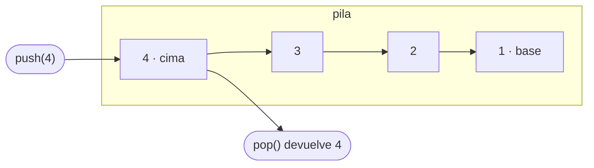

# Pila (stack)

> Una colección en la que el último valor que entra es el primero que sale: last in, first out (LIFO).

[Read in English](README.md)

## Modelo mental

Piensa en una pila de platos. Cada plato nuevo va arriba, y siempre se toma primero el plato de arriba. Nunca se saca uno del medio.

Cada valor apunta al que tiene debajo. `push` y `pop` solo tocan la cima, así que nunca necesitan recorrer la pila.

## Operaciones y complejidad

| Operación | Qué hace | Tiempo |
|---|---|---|
| `push(value)` | Añade un valor en la cima | O(1) |
| `pop()` | Quita y devuelve el valor de la cima | O(1) |
| `peek()` | Devuelve el valor de la cima sin quitarlo | O(1) |
| `size` / `isEmpty` | Cuenta los valores / comprueba si no hay ninguno | O(1) |
| iterar | Recorre todos los valores de la cima a la base | O(n) |

Una pila de n valores ocupa O(n) de espacio. Cada operación usa O(1) de espacio extra.

## Variantes

- **Pila enlazada** (la que construyes aquí): cada valor vive en un nodo que apunta al nodo de abajo. Todas las operaciones son O(1) en el peor caso, a cambio de una referencia extra por valor.
- **Pila sobre arreglo:** los valores viven en un arreglo dinámico y la cima es su última posición. Aprovecha mejor la caché y usa menos memoria por valor, pero un `push` que obliga a redimensionar cuesta O(n), así que `push` es O(1) *amortizado*.
- **Pila acotada:** tiene una capacidad fija y rechaza valores nuevos cuando está llena. Aparece en sistemas embebidos y en variantes de entrevista como "diseña una pila con tamaño máximo".

## Cuándo usarla

- **Deshacer/rehacer:** cada acción se apila, y deshacer quita la más reciente.
- **La pila de llamadas:** cada llamada a una función se apila y se quita cuando retorna.
- **Estructuras anidadas:** emparejar paréntesis, etiquetas HTML o bloques anidados.
- **Expresiones:** evaluar notación postfija y hacer parsing.
- **Navegación hacia atrás** en un navegador o una app.

**Señales en entrevistas:** "el más reciente sin emparejar…", "anidado", "deshacer", "evalúa esta expresión", "el siguiente elemento mayor o menor", o convertir un proceso recursivo en uno iterativo.

## Trade-offs

- **Pila vs. cola:** una cola devuelve el valor más antiguo (FIFO); una pila, el más reciente (LIFO).
- **Pila vs. arreglo:** un arreglo da acceso por índice. Una pila restringe a propósito el acceso a la cima, lo que deja clara la intención y evita usos indebidos.
- **Enlazada vs. sobre arreglo:** la enlazada garantiza `push` O(1) en el peor caso y nunca desperdicia capacidad; la de arreglo tiene mejor localidad de memoria y menos coste por valor.

## Contrato de la API

Todos los lenguajes implementan las mismas operaciones, y los tests comprueban estas reglas:

1. Una pila nueva está vacía: su tamaño es 0 e `isEmpty` es verdadero.
2. `push` aumenta el tamaño en uno, y la pila deja de estar vacía.
3. `peek` devuelve el último valor insertado sin quitarlo.
4. `pop` devuelve los valores en orden LIFO y reduce el tamaño en uno.
5. `pop` y `peek` sobre una pila vacía señalan la ausencia con la convención del lenguaje (ver la tabla de abajo).
6. Una vez vaciada, la pila vuelve a estar vacía y se puede reutilizar.
7. Las llamadas intercaladas a `push` y `pop` mantienen el orden LIFO.
8. Iterar recorre los valores de la cima a la base y no modifica la pila.
9. Funciona con cualquier tipo de valor, no solo con números.
10. Los valores "falsy" o cero (`0`, `""`, `false`, `null`/`None`/`nil`) se guardan y se devuelven como cualquier otro.
11. Soporta 100 000 valores sin quedarse sin memoria ni sin profundidad de recursión.

| Lenguaje | `pop` / `peek` con la pila vacía | Tamaño | Iteración |
|---|---|---|---|
| TypeScript | devuelve `undefined` | getter `size` | `for...of`, spread |
| Python | lanza `IndexError` | `len(stack)` | `for value in stack` |
| Java | lanza `NoSuchElementException` | `size()` | `for (T value : stack)` |
| Go | devuelve el valor cero y `false` | `Len()` | `for v := range s.All()`, que debe detenerse con `break` |

**Regla de implementación:** constrúyela con nodos enlazados. No uses el arreglo dinámico nativo del lenguaje (`Array`, `list`, `ArrayList`, slices) para guardar los valores, porque eso sería usar una pila ya hecha.

## Constrúyela

| Lenguaje | Starter | Solución | Tests | Correr los tests |
|---|---|---|---|---|
| TypeScript | [starter.ts](../../typescript/src/stack/starter.ts) | [solution.ts](../../typescript/src/stack/solution.ts) | [stack.test.ts](../../typescript/src/stack/stack.test.ts) | `npm test -- stack` |
| Python | [starter.py](../../python/ds/stack/starter.py) | [solution.py](../../python/ds/stack/solution.py) | [test_stack.py](../../python/ds/stack/test_stack.py) | `uv run pytest ds/stack` |
| Java | [Stack.java](../../java/src/starter/java/ds/stack/Stack.java) | [Stack.java](../../java/src/solution/java/ds/stack/Stack.java) | [StackTest.java](../../java/src/test/java/ds/stack/StackTest.java) | `./gradlew test --tests "ds.stack.*"` |
| Go | [starter.go](../../go/stack/starter.go) | [solution.go](../../go/stack/solution.go) | [stack_test.go](../../go/stack/stack_test.go) | `go test ./stack` |

Corre cada comando desde la carpeta de su lenguaje. La guía de cada lenguaje explica la instalación y cómo correr los tests contra la solución.

## Ejercicios

<!-- exercises:start -->
| # | Ejercicio | Dificultad | Qué practica | Solución |
| --- | --- | --- | --- | --- |
| 1 | [Baseball Game](https://leetcode.com/problems/baseball-game/) | Fácil | Usar push, pop y peek para llevar un registro | — |
| 2 | [Valid Parentheses](https://leetcode.com/problems/valid-parentheses/) | Fácil | Emparejar cada cierre con la apertura más reciente | — |
| 3 | [Implement Queue using Stacks](https://leetcode.com/problems/implement-queue-using-stacks/) | Fácil | Invertir el orden LIFO con una segunda pila | — |
| 4 | [Min Stack](https://leetcode.com/problems/min-stack/) | Media | Extender una pila para que todas sus operaciones, incluido el mínimo, sean O(1) | — |
| 5 | [Evaluate Reverse Polish Notation](https://leetcode.com/problems/evaluate-reverse-polish-notation/) | Media | Guardar operandos en una pila hasta que un operador los consuma | — |
| 6 | [Daily Temperatures](https://leetcode.com/problems/daily-temperatures/) | Media | Mantener en la pila los días pendientes hasta que uno más cálido los resuelva | — |
| 7 | [Decode String](https://leetcode.com/problems/decode-string/) | Media | Guardar el contexto exterior en una pila mientras se decodifican corchetes anidados | — |
| 8 | [Largest Rectangle in Histogram](https://leetcode.com/problems/largest-rectangle-in-histogram/) | Difícil | Mantener barras candidatas en la pila y resolverlas cuando aparece una más baja | — |
<!-- exercises:end -->
