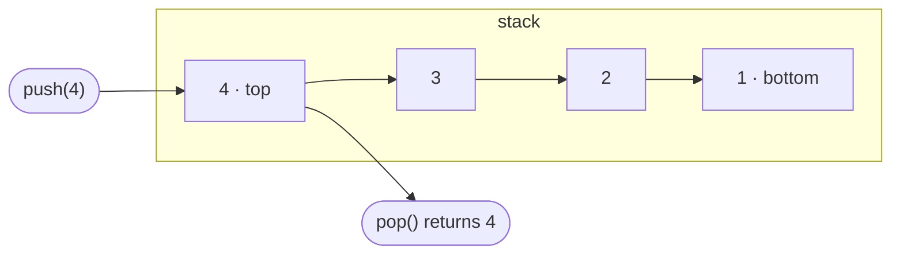

# Stack

> A collection where the last value added is the first one removed: last in, first out (LIFO).

[Leer en español](README.es.md)

## Mental model

Think of a pile of plates. You put each new plate on top, and you always take the top plate first. You never reach into the middle of the pile.

Each value points to the one below it. `push` and `pop` only touch the top, so they never need to walk the pile.

## Operations and complexity

| Operation | What it does | Average time | Worst-case time | Extra space |
|---|---|---|---|---|
| `push(value)` | Adds a value on top | O(1) | O(1) | O(1) |
| `pop()` | Removes and returns the top value | O(1) | O(1) | O(1) |
| `peek()` | Returns the top value without removing it | O(1) | O(1) | O(1) |
| `size` / `isEmpty` | Counts the values / checks whether there are none | O(1) | O(1) | O(1) |
| iterate | Visits every value from top to bottom | O(n) | O(n) | O(1) |

A stack of n values uses O(n) space in total. With linked nodes the worst case matches the average; an array-backed stack has an O(n) worst-case `push` (see Variants).

## Variants

- **Linked stack** (the one you build here): each value lives in a node that points to the node below. Every operation is O(1) in the worst case, at the cost of one extra reference per value.
- **Array-backed stack:** the values live in a dynamic array and the top is its last position. It is cache-friendly and uses less memory per value, but a `push` that triggers a resize costs O(n), so `push` is O(1) *amortized*.
- **Bounded stack:** it has a fixed capacity and rejects new values when it is full. It shows up in embedded systems and in interview variants such as "design a stack with a maximum size".

## When to use it

- **Undo/redo:** every action is pushed, and undo pops the most recent one.
- **The call stack:** each function call is pushed and removed when it returns.
- **Nested structures:** matching parentheses, HTML tags or nested blocks.
- **Expressions:** evaluating postfix notation and parsing.
- **Back navigation** in a browser or an app.

**Interview signals:** "the most recent unmatched…", "nested", "undo", "evaluate this expression", "the next greater or smaller element", or turning a recursive process into an iterative one.

## Trade-offs

- **Stack vs. queue:** a queue returns the oldest value (FIFO); a stack returns the newest one (LIFO).
- **Stack vs. array:** an array gives access by index. A stack deliberately restricts access to the top, which makes the intent clear and prevents misuse.
- **Linked vs. array-backed:** a linked stack gives a worst-case O(1) `push` and never wastes capacity; an array-backed one has better memory locality and less overhead per value.

## API contract

Every language implements the same operations, and the tests check these rules:

1. A new stack is empty: its size is 0 and `isEmpty` is true.
2. `push` increases the size by one, and the stack stops being empty.
3. `peek` returns the last pushed value without removing it.
4. `pop` returns the values in LIFO order and decreases the size by one.
5. `pop` and `peek` on an empty stack report the absence with the convention of the language (see the table below).
6. Once emptied, the stack is empty again and can be reused.
7. Interleaved `push` and `pop` calls keep the LIFO order.
8. Iterating visits the values from top to bottom and does not modify the stack.
9. It works with any type of value, not only numbers.
10. Falsy or zero values (`0`, `""`, `false`, `null`/`None`/`nil`) are stored and returned like any other value.
11. It handles 100,000 values without running out of memory or recursion depth.

| Language | Empty `pop` / `peek` | Size | Iteration |
|---|---|---|---|
| TypeScript | returns `undefined` | `size` getter | `for...of`, spread |
| Python | raises `IndexError` | `len(stack)` | `for value in stack` |
| Java | throws `NoSuchElementException` | `size()` | `for (T value : stack)` |
| Go | returns the zero value and `false` | `Len()` | `for v := range s.All()`, which must stop on `break` |

**Implementation rule:** build it on linked nodes. Do not use the native dynamic array of the language (`Array`, `list`, `ArrayList`, slices) as storage, because that would be using a ready-made stack.

## Build it

| Language | Starter | Solution | Tests | Run the tests |
|---|---|---|---|---|
| TypeScript | [starter.ts](../../typescript/src/stack/starter.ts) | [solution.ts](../../typescript/src/stack/solution.ts) | [stack.test.ts](../../typescript/src/stack/stack.test.ts) | `npm test -- stack` |
| Python | [starter.py](../../python/ds/stack/starter.py) | [solution.py](../../python/ds/stack/solution.py) | [test_stack.py](../../python/ds/stack/test_stack.py) | `uv run pytest ds/stack` |
| Java | [Stack.java](../../java/src/starter/java/ds/stack/Stack.java) | [Stack.java](../../java/src/solution/java/ds/stack/Stack.java) | [StackTest.java](../../java/src/test/java/ds/stack/StackTest.java) | `./gradlew test --tests "ds.stack.*"` |
| Go | [starter.go](../../go/stack/starter.go) | [solution.go](../../go/stack/solution.go) | [stack_test.go](../../go/stack/stack_test.go) | `go test ./stack` |

Run each command from the folder of its language. The guide of each language explains the setup and how to run the tests against the solution.

## Exercises

<!-- exercises:start -->
| # | Exercise | Difficulty | Practices | Solution |
| --- | --- | --- | --- | --- |
| 1 | [Baseball Game](https://leetcode.com/problems/baseball-game/) | Easy | Use push, pop and peek to keep a running record | — |
| 2 | [Valid Parentheses](https://leetcode.com/problems/valid-parentheses/) | Easy | Match each closing bracket with the most recent opening one | — |
| 3 | [Implement Queue using Stacks](https://leetcode.com/problems/implement-queue-using-stacks/) | Easy | Reverse the LIFO order with a second stack | — |
| 4 | [Min Stack](https://leetcode.com/problems/min-stack/) | Medium | Extend a stack so every operation, including min, stays O(1) | — |
| 5 | [Evaluate Reverse Polish Notation](https://leetcode.com/problems/evaluate-reverse-polish-notation/) | Medium | Keep operands on a stack until an operator consumes them | — |
| 6 | [Daily Temperatures](https://leetcode.com/problems/daily-temperatures/) | Medium | Keep pending days on a stack until a warmer day resolves them | — |
| 7 | [Decode String](https://leetcode.com/problems/decode-string/) | Medium | Save the outer context on a stack while decoding nested brackets | — |
| 8 | [Largest Rectangle in Histogram](https://leetcode.com/problems/largest-rectangle-in-histogram/) | Hard | Keep candidate bars on a stack and resolve them when a shorter bar appears | — |
<!-- exercises:end -->
